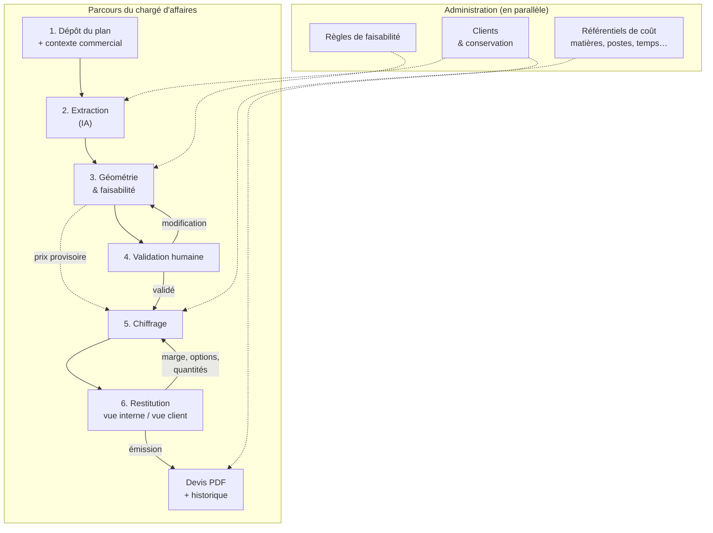
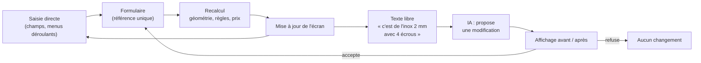
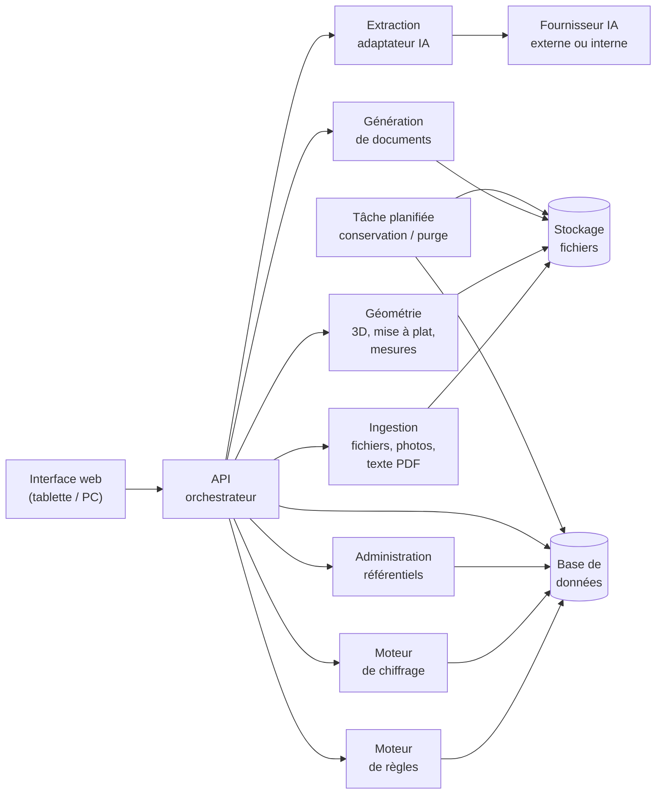
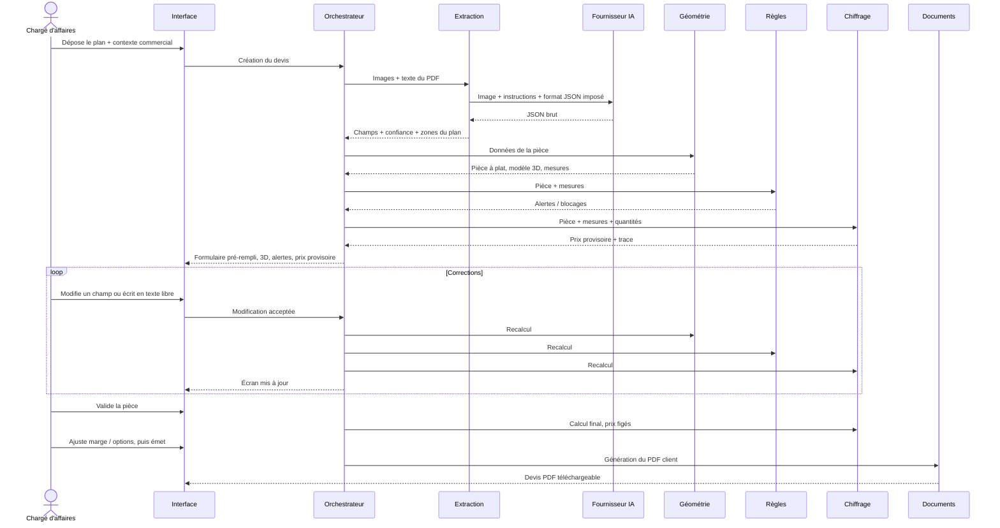
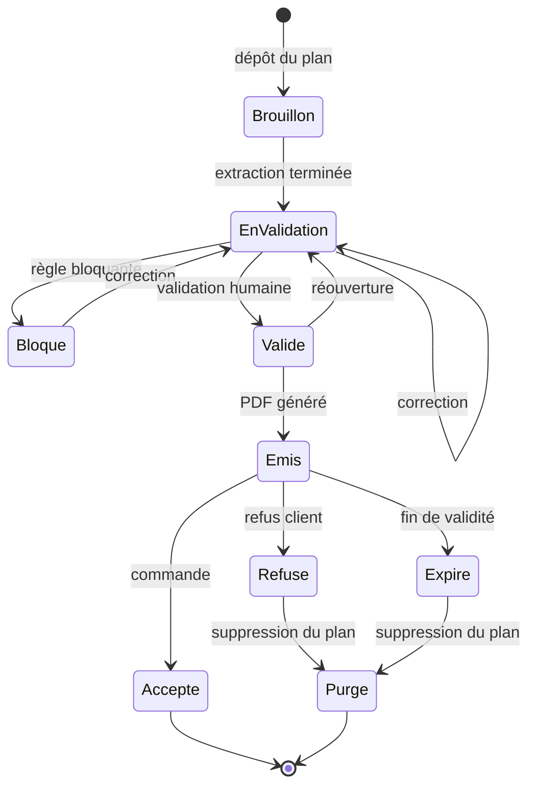
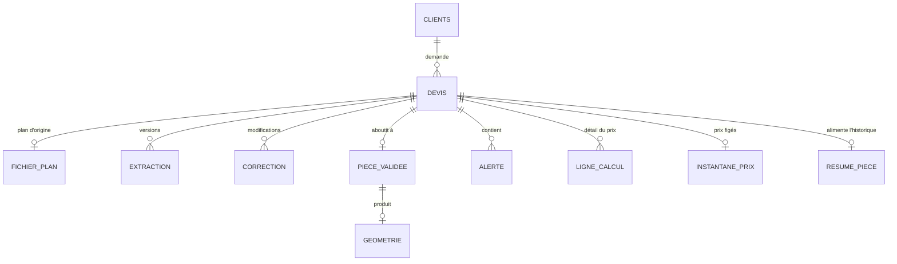
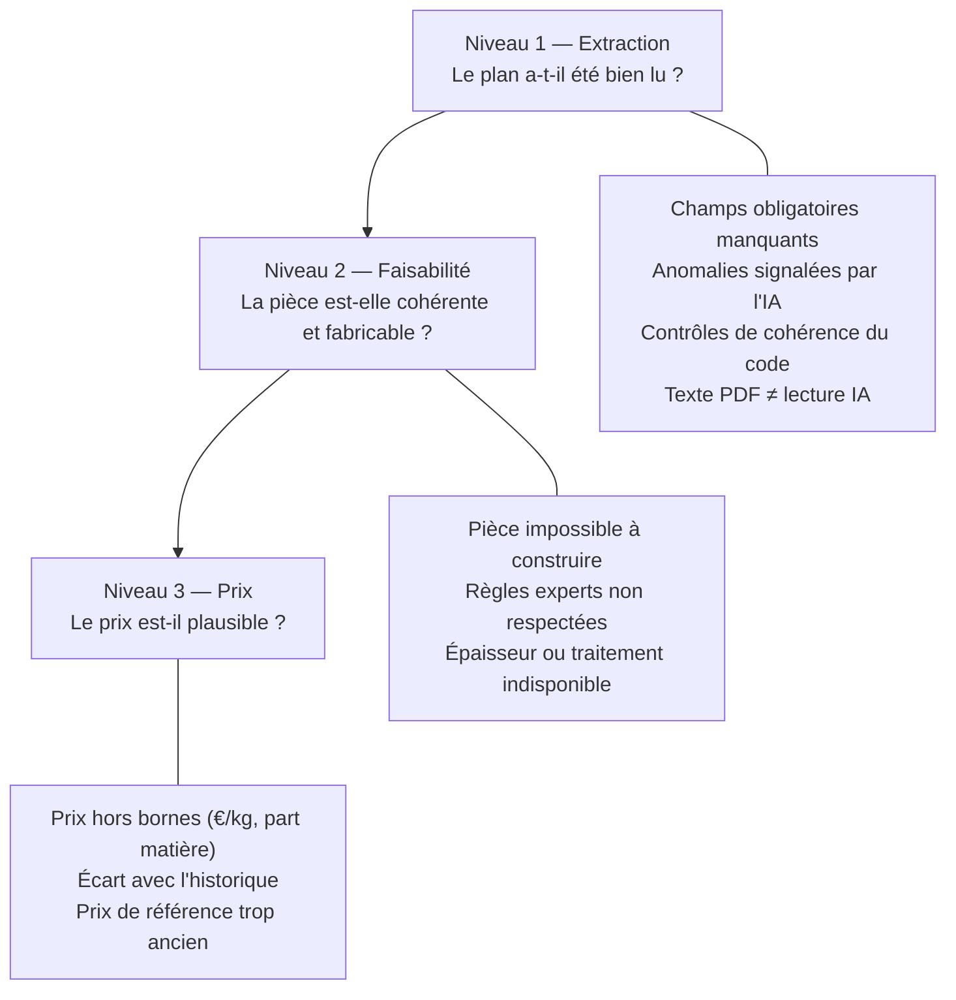

# Architecture — Générateur de devis tôlerie

Ce document décrit l'architecture fonctionnelle et technique de l'outil : le parcours utilisateur, les services, les flux de données, la gestion des erreurs, ainsi que la traçabilité et la confidentialité.

Il s'appuie sur :
- [logique_metier.md](logique_metier.md) : les formules de chiffrage (6 blocs de coût) ;
- [sources_donnees.md](sources_donnees.md) : les tables de référence utilisées par le calcul ;
- [resultats.md](resultats.md) : les résultats de l'étude sur la qualité de l'extraction, qui ont fixé le choix du modèle et les contrôles décrits ici.

> Les schémas sont écrits en [Mermaid](https://mermaid.js.org/) : ils s'affichent sur GitHub et dans la plupart des éditeurs (extension « Markdown Preview Mermaid Support » pour VS Code), et se modifient directement dans le texte.

---

## Sommaire

1. [Principes directeurs](#1-principes-directeurs)
2. [Parcours utilisateur](#2-parcours-utilisateur)
3. [Détail des étapes](#3-détail-des-étapes)
4. [Boucle de validation](#4-boucle-de-validation)
5. [Services techniques](#5-services-techniques)
6. [Flux de données](#6-flux-de-données)
7. [Cycle de vie d'un devis](#7-cycle-de-vie-dun-devis)
8. [Modèle de données](#8-modèle-de-données)
9. [Intégration de l'IA](#9-intégration-de-lia)
10. [Gestion des erreurs](#10-gestion-des-erreurs)
11. [Traçabilité et confidentialité](#11-traçabilité-et-confidentialité)
12. [Administration](#12-administration)
13. [Stack technique proposée](#13-stack-technique-proposée)
14. [Périmètre V1 / V2](#14-périmètre-v1--v2)
15. [Évaluation de l'extraction](#15-évaluation-de-lextraction)
16. [Décisions et points ouverts](#16-décisions-et-points-ouverts)

---

## 1. Principes directeurs

| # | Principe | Conséquence |
|---|---|---|
| 1 | **L'IA lit, le code calcule** | L'IA extrait des données brutes du plan. Toute géométrie (développé, longueur de coupe, masse) et tout prix sont calculés par du code déterministe. |
| 2 | **L'humain valide** | Aucun devis n'est émis sans validation des données extraites par un chargé d'affaires. |
| 3 | **Le formulaire est la référence unique** | Toutes les corrections (saisie directe ou texte libre) passent par le formulaire structuré. |
| 4 | **Aucune valeur en dur** | Prix, temps, taux et règles viennent des tables de référence, modifiables sans développeur. |
| 5 | **Tout est traçable** | Chaque devis garde l'extraction brute, les corrections, les valeurs finales et les prix figés au moment de l'émission. |
| 6 | **Confidentialité dès la conception** | Les plans clients sont séparés des données résumées et ont une durée de conservation définie par client. |

---

## 2. Parcours utilisateur



Lecture :
- Les étapes 3 et 5 sont **recalculées à chaque modification** à l'étape 4. Elles sont rapides (moins d'une seconde) car entièrement déterministes.
- Le prix est affiché comme **provisoire** pendant la validation, puis **figé** une fois la pièce validée.
- L'administration n'est pas une étape du parcours : elle est utilisée par d'autres personnes (acheteur, bureau des méthodes, contrôle de gestion) et alimente les étapes en données.

---

## 3. Détail des étapes

### Étape 1 — Dépôt du plan et contexte commercial

| | |
|---|---|
| **Entrées** | PDF (vectoriel ou scanné), image (PNG, JPG), photo prise depuis une tablette ou un téléphone |
| **Contexte saisi** | Client, quantités souhaitées (paliers), délai, matière et traitement **si absents du plan** |
| **Traitements** | Détection du type de PDF (texte lisible ou non), conversion en image haute résolution, redressement et contrôle de netteté des photos |
| **Sorties** | Fichier stocké, images des pages, texte du PDF s'il existe |
| **Erreurs détectées** | Format non supporté, photo floue ou de travers, fichier vide, plusieurs pièces sur le même plan |

La quantité, le client et le délai ne figurent jamais sur un plan. Ils sont pourtant indispensables au prix : on les demande dès le dépôt.

### Étape 2 — Extraction

| | |
|---|---|
| **Entrées** | Images des pages, texte du PDF, contexte commercial |
| **Traitements** | Lecture du texte du PDF quand il existe (cotes, notes, nomenclature, exactes et sans OCR). L'IA comprend ensuite le dessin et produit un JSON au format imposé. |
| **Sorties** | Pour chaque champ : valeur, **niveau de confiance**, **zone du plan** d'où il vient |
| **Erreurs détectées** | Champs obligatoires manquants, réponse hors format, incohérence entre texte du PDF et lecture de l'IA, **anomalies signalées par l'IA**, **contrôles de cohérence par le code** (voir ci-dessous) |

Ce que l'IA extrait : identification (référence, désignation), matière, épaisseur, profil de pliage (ailes, angles, rayons), largeur, trous et découpes, chanfreins, nomenclature (composants), notes, traitement, tolérances.

Ce que l'IA **ne calcule pas** : surface développée, longueur de coupe, masse, prix.

**Signalements et contrôles.** L'étude a montré deux choses ([resultats.md](resultats.md)) :
- l'IA **signale** bien les problèmes du plan au lieu d'inventer (information absente, cotes contradictoires, quantité de trous fausse, traitement impossible : 27 cas sur 28 avec le modèle retenu) ;
- mais elle **recopie** la valeur écrite (« 6x Ø8,5 » donne 6 trous, même si 2 sont dessinés) et peut, sur une photo, **mal lire un chiffre sans le signaler** (2 profils de pliage sur 50).

Les signalements de l'IA sont donc affichés en premier à la validation, et doublés par des **contrôles faits par le code**, qui ne dépendent pas du modèle :

| Contrôle | Ce qu'il attrape |
|---|---|
| Somme des ailes (+ épaisseurs) = encombrement coté | Cote mal lue, cotes contradictoires |
| Encombrement recalculé à partir du profil et de la largeur | Encombrement faux ou manquant ; aile oubliée dans le profil (la hauteur ne correspond plus : erreur fréquente des modèles plus faibles sur les pièces à 4 plis) |
| Quantité de trous ≥ quantité de composants à sertir | Rappel de quantité incohérent |
| Positions de trous dans les limites de la pièce | Cote de position fausse |
| Traitement compatible avec la famille de matière (table `traitements`) | Anodisation sur acier, galvanisation sur aluminium… |

**Unités.** L'IA recopie les cotes dans l'unité du plan (`unites` : mm ou in) ; la conversion est faite **par le code** (`unites.py`), jamais par l'IA. Elle a lieu dans le pipeline du devis, juste après l'extraction et avant matière, géométrie, faisabilité et chiffrage — **pas dans `extraire()`** : l'évaluation compare la sortie brute aux vérités terrain, qui sont dans l'unité du plan. Sur un plan en pouces, toutes les longueurs de la pièce (épaisseur, encombrement, ailes, rayons, trous, coins, soudures, cotes linéaires, zones de tolérance géométrique) sont multipliées par 25,4 ; les angles, quantités, confiances, rugosités et textes restent tels quels. Chaque valeur convertie est tracée (chemin, valeur en pouces, valeur en mm) et l'écran de validation l'affiche (« lu sur le plan : 0,06 in → 1,52 mm »). Aucun arrondi vers une épaisseur du stock : 1,524 mm est signalé par la faisabilité, l'utilisateur corrige. Unité non lue → aucune conversion et alerte « unité non lue » affichée avant le formulaire. Écartés en V1 :
- les **gauges** (16 ga, 24 ga) : la correspondance dépend de la matière (16 ga = 0,0598 in en acier, 0,0508 in en aluminium, 0,0635 in en galvanisé) ; il faudrait une table de référentiel, un champ au schéma et une règle de prompt. Les plans en pouces décimaux sont couverts sans elles ;
- l'**heuristique « épaisseur < 0,3 → unité suspecte »** : l'alerte « unité non lue » est déjà inconditionnelle, et quand l'unité est lue une heuristique la contredirait sans preuve (les épaisseurs < 0,1 restent bloquées à la validation).

### Étape 3 — Géométrie et faisabilité

**3a. Géométrie.** À partir des données extraites, le code construit :
- **la pièce à plat** (polygone 2D avec trous), calculée avec la formule du développé ;
- **le modèle 3D**, en extrudant le profil de pliage sur la largeur puis en retirant trous et chanfreins.

Les **mesures** utilisées par le chiffrage viennent de la pièce à plat, pas de l'IA :

| Mesure | Calcul |
|---|---|
| Rectangle englobant du flan | boîte englobante du polygone à plat |
| Surface nette | aire du polygone moins les trous |
| Longueur de coupe | périmètre extérieur + périmètres des trous |
| Nombre d'amorçages | 1 + nombre de contours intérieurs |
| Masse | surface nette × épaisseur × densité |

Si la pièce ne peut pas être construite (cotes contradictoires, aile de longueur négative), c'est déjà une erreur détectée.

Limite V1 : pièces dont **tous les plis sont parallèles** (supports, pattes, profils en L, U, Z). Les pièces avec des plis dans plusieurs directions sont prévues en V2.

**3b. Faisabilité.** Le moteur de règles évalue les règles définies par les experts métier :

| Exemple de règle | Paramètre type |
|---|---|
| Diamètre de trou ≥ épaisseur | 1,0 × e |
| Distance trou / bord ≥ k × épaisseur | 1,5 × e |
| Distance trou / pli ≥ 2 × épaisseur + rayon | 2 × e + R |
| Longueur d'aile ≥ minimum de l'outillage | 4 × e |
| Rayon de pliage ≥ épaisseur | 1,0 × e (plus pour certains aluminiums) |
| Rayon de pliage ≤ k × épaisseur | 8 × e (alerte : outillage spécial) |
| Rayon de pliage ≤ aile adjacente | 1 × aile (blocage) |
| Dimensions du flan ≤ format de tôle et longueur de plieuse | selon `postes` |
| Épaisseur disponible pour la matière | selon `epaisseurs_dispo` |
| Traitement compatible avec la matière | galva → acier, anodisation → alu, passivation → inox |
| Épaisseur minimale pour un écrou à sertir | selon le composant |

Chaque règle produit une **alerte** (à vérifier) ou un **blocage** (devis impossible en l'état).

### Étape 4 — Validation humaine

L'écran présente côte à côte :
- le **plan d'origine**, avec surlignage de la zone d'un champ quand on clique dessus ;
- le **formulaire** pré-rempli, avec en premier les **anomalies** (signalées par l'IA ou par les contrôles du code), puis les champs manquants ou peu sûrs ;
- le **modèle 3D** et des vues dessus / côté au même cadrage que le plan, pour comparer d'un coup d'œil ;
- les **alertes** de faisabilité ;
- le **prix provisoire**.

Les deux modes de correction sont détaillés en [section 4](#4-boucle-de-validation).

### Étape 5 — Chiffrage

| | |
|---|---|
| **Entrées** | Pièce validée, mesures géométriques, quantités, client |
| **Traitements** | Application des formules des 6 blocs ([logique_metier.md](logique_metier.md)) avec les tables de référence ([sources_donnees.md](sources_donnees.md)) |
| **Sorties** | Coût et prix par palier de quantité, **trace de chaque ligne** (formule, valeurs, table d'origine, date du prix) |
| **Erreurs détectées** | Bornes de `bornes_controle`, écart avec des devis similaires de l'historique, prix matière trop ancien |

À la validation, les valeurs utilisées sont **figées** dans le devis : le devis ne change plus si un prix de référence évolue ensuite.

### Étape 6 — Restitution et émission

| Vue interne | Vue client |
|---|---|
| Détail par bloc de coût | Désignation, référence |
| Temps, taux, réglages | Prix unitaire et total par palier de quantité |
| Marge appliquée (modifiable) | Options (ex. peinture) |
| Alertes et comparaison avec l'historique | Délai, validité, conditions |
| Trace complète du calcul | — |

Les modifications (marge, options, quantités) sont enregistrées avec leur auteur. L'émission génère le PDF client et ajoute le devis à l'historique.

---

## 4. Boucle de validation



- Les menus déroulants sont alimentés par les tables de référence (matières, épaisseurs disponibles, traitements, composants) : on ne peut pas saisir une matière inconnue.
- Le texte libre **ne modifie jamais directement** les données. L'IA traduit la demande en modification du formulaire, que l'utilisateur accepte ou refuse.
- Chaque correction est enregistrée (valeur avant, valeur après, auteur, mode de saisie). Ces corrections servent à mesurer la qualité de l'extraction (voir [section 11](#11-traçabilité-et-confidentialité)).

---

## 5. Services techniques



| Service | Rôle | Déterministe ? |
|---|---|---|
| **Interface web** | Écrans du parcours et de l'administration, utilisable sur tablette | — |
| **API / orchestrateur** | Enchaîne les étapes, gère le statut du devis, enregistre la trace | Oui |
| **Ingestion** | Réception des fichiers, conversion en images, lecture du texte PDF, redressement des photos | Oui |
| **Extraction** | Envoi au fournisseur IA, contrôle du format de réponse, fusion avec le texte du PDF | **Non (IA)** |
| **Géométrie** | Construction de la pièce à plat et du modèle 3D, calcul des mesures | Oui |
| **Moteur de règles** | Évaluation des règles de faisabilité et des bornes de contrôle | Oui |
| **Moteur de chiffrage** | Calcul des 6 blocs, marge, paliers, trace | Oui |
| **Génération de documents** | PDF client, export de la vue interne | Oui |
| **Administration** | Gestion des tables de référence, des règles et des clients | Oui |
| **Conservation / purge** | Suppression des plans et modèles selon les règles de chaque client | Oui |

Seul le service d'extraction (et l'assistant de correction) fait appel à l'IA. Tout le reste est reproductible : même entrée, même résultat.

En V1, ces services peuvent être des **modules d'une même application** plutôt que des services séparés. Le découpage reste le même, ce qui permet de les séparer plus tard si besoin.

---

## 6. Flux de données



---

## 7. Cycle de vie d'un devis



La suppression du plan après un refus ou une expiration dépend des réglages du client (voir [section 11](#11-traçabilité-et-confidentialité)). Les caractéristiques résumées et le devis émis restent dans l'historique.

---

## 8. Modèle de données

Les tables de référence (matières, postes, temps, composants, traitements, paramètres, clients, bornes) sont décrites dans [sources_donnees.md](sources_donnees.md). Ce schéma montre les objets propres à un devis.



| Objet | Contenu | Sensibilité |
|---|---|---|
| `DEVIS` | Numéro, client, statut, quantités, marge, auteur, dates | Moyenne |
| `FICHIER_PLAN` | Fichier d'origine, images des pages, texte PDF | **Très forte** (propriété du client) |
| `EXTRACTION` | JSON brut renvoyé par l'IA, fournisseur, version du prompt, durée | Forte |
| `CORRECTION` | Champ, valeur avant / après, auteur, mode (formulaire ou texte libre) | Forte |
| `PIECE_VALIDEE` | Données de la pièce après validation humaine | Forte |
| `GEOMETRIE` | Pièce à plat (DXF), modèle 3D, mesures | **Très forte** (permet de reconstruire la pièce) |
| `ALERTE` | Règle, niveau, message, statut (vue / ignorée avec justification) | Faible |
| `LIGNE_CALCUL` | Bloc, formule, valeurs, table d'origine, date du prix | Moyenne |
| `INSTANTANE_PRIX` | Copie des valeurs de référence utilisées | Faible |
| `RESUME_PIECE` | Matière, épaisseur, dimensions hors-tout, nb plis / trous / composants, prix | Faible (ne permet pas de reconstruire la pièce) |

---

## 9. Intégration de l'IA

### 9.1 Où intervient l'IA

| Moment | Rôle de l'IA | Garde-fou |
|---|---|---|
| Étape 2 — Extraction | Comprendre le plan et produire un JSON structuré | Format imposé, confiance par champ, contrôles de cohérence, validation humaine |
| Étape 4 — Assistant | Traduire une correction en texte libre en modification du formulaire | Affichage avant / après, acceptation explicite |
| Étape 6 — Comparaison (option) | Retrouver des devis similaires dans l'historique | Seulement les caractéristiques résumées, jamais le plan d'un autre client |

L'IA n'intervient **ni dans la géométrie, ni dans les règles, ni dans le prix**.

### 9.2 Adaptateur de fournisseur

Le service d'extraction passe par une **interface commune** qui permet de changer de fournisseur sans toucher au reste :
- fournisseurs externes via API (Anthropic, OpenAI, Mistral, Azure OpenAI…) ;
- modèle hébergé en interne, pour les clients qui interdisent l'envoi de leurs plans à un tiers.

Le choix du fournisseur se fait selon le réglage du client (`ia_externe_autorisee`). Un abonnement grand public ne suffit pas : il faut un **contrat API ou entreprise** avec garantie de non-réutilisation des données.

**Modèles retenus**, d'après l'étude ([section 15](#15-évaluation-de-lextraction)) :

| Usage | Modèle | Pourquoi |
|---|---|---|
| **Par défaut** | **Claude Sonnet 5.5**, API Anthropic (contrat entreprise) | Meilleur sur tout ce qui coûte cher en cas d'erreur (profil de pliage, signalement des problèmes) ; ~0,05 $ par plan, négligeable devant le coût d'une erreur de devis |
| **Client qui refuse l'IA externe** | **Qwen3.8 27B**, hébergé en interne (poids publics) | Le meilleur des modèles testés après Claude ; plus de vérifications humaines à prévoir (profil de pliage juste à 78 – 88 % selon la qualité du plan) |
| Non retenu | Gemini 2.5 Flash | Bon sur le texte, mais oublie des plis et ne signale pas les incohérences |

L'adaptateur a déjà trois implémentations ([src/generateur_devis/llm/](../src/generateur_devis/llm/)) :
- **API au format OpenAI**, pour OpenRouter, Nous Research ou un modèle hébergé en interne (vLLM et la plupart des serveurs d'inférence exposent ce format) ;
- **Claude Code** (abonnement Claude) : utilisé **uniquement pour l'étude**, un abonnement grand public n'étant pas utilisable en production ;
- en production, l'API Anthropic directe s'ajoutera derrière la même interface.

[OpenRouter](https://openrouter.ai/) reste utile pour **comparer** de nouveaux modèles sur le jeu d'évaluation en changeant un seul paramètre. En production, il ajoute un intermédiaire entre l'usine et le fournisseur du modèle : on lui préfère un contrat direct avec le fournisseur retenu.

### 9.3 Format de sortie

Le format est défini une seule fois, en Pydantic ([piece.py](../src/generateur_devis/schema/piece.py)), et exporté en schéma JSON ([schemas/piece_extraite.schema.json](../schemas/piece_extraite.schema.json)) envoyé au modèle. Il sert à la fois à l'IA, à la validation, au formulaire et à l'évaluation.

Chaque champ simple porte sa valeur, la confiance annoncée et la zone du plan d'où il vient (en fraction de la page) :

```json
{
  "matiere": {
    "designation": { "valeur": null, "confiance": null, "source": null },
    "epaisseur": { "valeur": 2, "confiance": 0.95, "source": { "page": 1, "zone": [0.72, 0.88, 0.2, 0.03] } }
  },
  "profil_pliage": {
    "cotation": "exterieure",
    "elements": [
      { "type": "aile", "longueur": 18 },
      { "type": "pli", "angle": 90, "sens": "haut" },
      { "type": "aile", "longueur": 24 },
      { "type": "pli", "angle": 90, "sens": "bas" },
      { "type": "aile", "longueur": 42 }
    ],
    "confiance": 0.85
  },
  "anomalies": [
    { "type": "information_manquante", "champ": "matiere.designation",
      "description": "La matière n'est pas renseignée dans le cartouche (« — »)." }
  ]
}
```

Le champ `anomalies` est la sortie la plus utile de l'IA après les valeurs elles-mêmes : c'est là qu'elle dit ce qu'elle n'a pas pu lire ou ce qui lui semble faux.

---

## 10. Gestion des erreurs

Les erreurs sont détectées à **trois niveaux**, chacun avec sa réponse :



| Niveau | Détection | Correction |
|---|---|---|
| **1. Extraction** | Champ vide, anomalie signalée par l'IA, contrôle de cohérence du code en échec, réponse hors format, désaccord entre le texte du PDF et l'IA. La confiance annoncée seule ne suffit pas : les erreurs de lecture sur photo sont faites avec une confiance élevée | Champ mis en avant dans le formulaire, l'utilisateur complète ou corrige |
| **2. Faisabilité** | Modèle 3D impossible à construire, règle non respectée, dimensions hors capacité | Alerte ou blocage avec message clair. L'utilisateur corrige, ou justifie s'il ignore une alerte |
| **3. Prix** | Bornes de `bornes_controle`, écart > 30 % avec des pièces similaires, prix matière ancien | Alerte dans la vue interne, avec le détail du calcul pour trouver la ligne en cause |

### Scénario de démonstration

En reprenant les erreurs de la fiche [devis.pdf](../exercise_information/devis.pdf) fournie :

| Erreur | Niveau | Ce que voit l'utilisateur |
|---|---|---|
| Matière « non renseignée » | 1 | Champ obligatoire en rouge, prix non calculable tant qu'il est vide |
| Plis à 45° au lieu de 90° | 2 | Le modèle 3D ne correspond visiblement pas au plan, et la hauteur de 22 mm ne peut pas être atteinte |
| Surface développée de 0,0004 m² | — | Impossible dans notre architecture : la surface est calculée par le code à partir de la pièce à plat |
| Longueur de découpe de 40 mm | — | Idem : calculée par le code (≈ 343 mm) |
| Prix aberrant volontairement introduit | 3 | Alerte « écart de +180 % avec 3 pièces similaires », avec le détail du calcul |

---

## 11. Traçabilité et confidentialité

> Les points ci-dessous structurent l'architecture. Ils sont à valider avec le service juridique ou le DPO du groupe.

### 11.1 Le cadre

- **Les plans sont la propriété intellectuelle du client**, protégés par le secret des affaires et généralement par un accord de confidentialité ou les conditions générales d'achat du client. Ces clauses limitent souvent l'usage du plan à la réponse à la demande de prix, et imposent sa destruction sur demande ou si la commande n'aboutit pas.
- **Usage prévu** : le plan est transmis pour obtenir un devis. L'utiliser pour améliorer un modèle est un autre usage, qui demande une base contractuelle ou l'accord explicite du client.
- **Envoi à un fournisseur d'IA** : c'est un transfert à un tiers. Il faut un contrat de sous-traitance, une garantie de non-réutilisation des données et idéalement un hébergement en Europe. Certains clients l'interdisent.
- **RGPD** : le cartouche peut contenir des noms ou contacts (données personnelles), à limiter au strict nécessaire.
- **AI Act** : un outil d'aide au devis n'entre pas dans les systèmes à haut risque. Les obligations sont limitées (transparence, supervision humaine, déjà prévue).

### 11.2 Séparer les données selon leur sensibilité

| Donnée | Propriétaire | Conservation proposée |
|---|---|---|
| Plan d'origine | Client | Pendant la consultation. Suppression si offre refusée, expirée ou sur demande, sinon selon le contrat |
| Géométrie complète (3D, mise à plat) | Client | Même règle que le plan |
| Extraction brute et corrections | Mixte | Même règle que le plan, sauf accord du client pour l'évaluation |
| Résumé de la pièce (matière, épaisseur, dimensions hors-tout, nb plis / trous, prix) | Maji | Conservé, pour l'historique et la comparaison des prix |
| Devis émis | Maji | Conservé (obligatoire s'il devient une commande) |

Ce qui sert à comparer les prix **ne permet pas de reconstruire la pièce** : l'historique survit à la suppression du plan.

### 11.3 Réglages par client

Ajouts à la table `clients` ([sources_donnees.md §3.1](sources_donnees.md#31-clients)) :

| Colonne | Défaut | Effet |
|---|---|---|
| `ia_externe_autorisee` | non | Si non : modèle interne ou saisie manuelle assistée |
| `reutilisation_autorisee` | non | Si oui : le plan et ses corrections peuvent rejoindre le jeu d'évaluation |
| `duree_conservation_plans_jours` | 90 | Délai avant suppression automatique |
| `suppression_si_refus` | oui | Suppression du plan dès le refus de l'offre |

Par défaut, on applique la règle **la plus protectrice**.

### 11.4 Suppression et preuve

Une tâche planifiée supprime les plans, géométries, extractions et corrections selon ces réglages. Chaque suppression est enregistrée (quoi, quand, pourquoi) pour pouvoir le prouver au client.

### 11.5 Améliorer l'outil sans entraîner de modèle

L'architecture **n'a pas besoin d'entraîner de modèle**. On améliore l'extraction en ajustant les instructions données à l'IA, et on mesure la qualité sur un **jeu d'évaluation** :
- composé uniquement de plans autorisés : clients ayant donné leur accord, plans internes à Maji, plans créés pour l'occasion ;
- avec les bonnes réponses connues pour chaque champ ;
- qui produit un taux de bonnes réponses par champ, suivi à chaque changement de prompt ou de fournisseur.

Les corrections faites par les utilisateurs (sur les plans autorisés) enrichissent ce jeu d'évaluation au fil du temps.

---

## 12. Administration

Espace séparé du parcours, utilisé par d'autres profils :

| Écran | Utilisateur | Tables |
|---|---|---|
| Matières et épaisseurs | Acheteur | `matieres`, `epaisseurs_dispo` |
| Composants et traitements | Acheteur | `composants`, `traitements` |
| Postes et taux horaires | Contrôleur de gestion | `postes` |
| Temps standards | Bureau des méthodes | `vitesses_coupe`, `temps_pliage`, `operations` |
| Règles de faisabilité et bornes | Bureau des méthodes | `regles_faisabilite`, `bornes_controle` |
| Clients et conservation | Direction commerciale | `clients`, `parametres` |
| Qualité de l'extraction | Data scientist | Jeu d'évaluation, résultats |

Chaque modification est datée et attribuée. Les devis déjà émis ne sont pas affectés, grâce aux prix figés.

---

## 13. Stack technique proposée

> **Décidé** : Python, Streamlit, Claude Sonnet par défaut et Qwen en interne en repli (voir [section 9.2](#92-adaptateur-de-fournisseur)), modèle 3D dès la V1 (abandonné s'il s'avère trop coûteux à mettre au point). Le reste est une proposition.

| Brique | Proposition | Pourquoi |
|---|---|---|
| Langage backend | **Python** | Écosystème data, CAO (CadQuery) et IA |
| API | **FastAPI** | Simple, typée, documentation automatique |
| Schémas de données | **Pydantic** | Même définition pour le format JSON de l'IA, l'API et la validation |
| Lecture PDF | **PyMuPDF** | Texte du PDF + rendu en image |
| IA | **Claude Sonnet** (API Anthropic) ; **Qwen** hébergé en interne en repli ; OpenRouter pour les comparaisons. Une interface commune | Choix fondé sur l'étude ; changement de fournisseur sans impact |
| Photos | Pas de prétraitement imposé en V1 | Sur photo simulée, la lecture reste quasi intacte : à revoir sur les vraies photos de la phase pilote |
| Pièce à plat et mesures | **Shapely** + **ezdxf** | Polygone 2D, aire, périmètre, export DXF |
| Modèle 3D | **CadQuery** ou **build123d**, export GLB / STL | Construction paramétrique en Python |
| Affichage 3D | **Plotly** (maillage 3D, intégré nativement à Streamlit) | Rotation / zoom sans développement front |
| Moteur de règles | Types de règles prédéfinis avec paramètres en base | Modifiable par les experts sans exécuter de code arbitraire |
| Base de données | **SQLite** (V1) → **PostgreSQL** | Simple pour le prototype, migration directe |
| Stockage fichiers | Dossier local (V1) → stockage objet (S3 / MinIO) | |
| PDF devis | **WeasyPrint** (HTML → PDF) | Mise en page en HTML/CSS |
| Interface | **Streamlit** | Tout en Python, rapide à développer et facile à relire. React reste une option pour une version de production plus adaptée à la tablette |

---

## 14. Périmètre V1 / V2

| Fonction | V1 (prototype) | V2 |
|---|---|---|
| Formats acceptés | PDF, image, photo | + STEP, DXF (géométrie exacte, sans IA) |
| Pièces | Une pièce par plan, plis parallèles | Plis dans plusieurs directions, assemblages, plans multi-pages |
| Extraction | Un fournisseur IA externe | Plusieurs fournisseurs + modèle interne |
| Correction | Formulaire + assistant texte libre | — |
| Géométrie | Pièce à plat + 3D simple | Détection des collisions au pliage |
| Faisabilité | ~10 règles | Règles complètes du bureau des méthodes |
| Chiffrage | 6 blocs, données simulées | Données réelles de chaque usine, calepinage réel |
| Historique | Faux devis simulés | Import des devis Excel existants |
| Confidentialité | Réglages par client + purge | Audit complet |
| Utilisateurs | Hors périmètre (utilisateur unique) | Authentification, rôles (chargé d'affaires, admin, direction) |
| Évaluation | Plans générés (propres, scan, photo, erronés, incohérents) + jeux publics + piece_003 (seul vrai plan disponible) | Phase pilote : qualité mesurée sur les vrais plans clients à partir des corrections du formulaire, puis suivi continu |

---

## 15. Évaluation de l'extraction

L'extraction est la seule étape non déterministe : c'est elle qu'il faut mesurer. Protocole : **[evaluation.md](evaluation.md)** ; résultats : **[resultats.md](resultats.md)** ; jeux et exemples en image : **[jeux_de_test.md](jeux_de_test.md)**.

### 15.1 Ce qui a été mesuré

- **Plans de tôlerie générés** avec leur bonne réponse (50 plans de test : plaque, L, U, Z, chapeau ; trous, coins, composants à sertir), lus en **PDF propre, scan et photo** simulés ;
- **plans erronés** (16) et **incohérents** (12) : l'IA signale-t-elle le problème ou invente-t-elle ?
- **jeux publics** : cadsy (30 plans CAO réalistes) et ecado (40 plans orientés devis) ;
- **3 modèles** avec le même prompt : Claude Sonnet 5.5, Gemini 2.5 Flash, Qwen3.8 27B (open source).

### 15.2 Résultats principaux

| | Claude Sonnet 5.5 | Gemini 2.5 Flash | Qwen3.8 27B |
|---|---|---|---|
| Profil de pliage (PDF / scan / photo) | **100 / 100 / 96 %** | 78 / 75 / 72 % | 84 / 88 / 78 % |
| Matière, épaisseur, trous, composants, cotes | ~100 % | ~100 % | ~100 % |
| Plans erronés signalés | **15 / 16** | 7 / 15 | 13 / 16 |
| Plans incohérents signalés | **12 / 12** | non testé | 7 / 12 |
| Coût par plan | ~0,05 $ | ~0,008 $ | ~0,024 $ |

### 15.3 Conséquences sur l'architecture

| Constat | Décision |
|---|---|
| Claude nettement meilleur sur la géométrie et les signalements, pour un coût négligeable | Claude Sonnet par défaut ([9.2](#92-adaptateur-de-fournisseur)) |
| Qwen correct, à poids publics | Repli hébergé en interne pour les clients qui refusent l'IA externe |
| L'IA recopie les valeurs écrites, même incohérentes, et peut mal lire un chiffre sur photo sans le signaler | Contrôles de cohérence par le code ([étape 2](#étape-2--extraction)) ; anomalies en tête du formulaire |
| La confiance annoncée ne repère pas les erreurs de lecture | Ne pas trier la vérification sur la seule confiance |
| Scan et photo simulés ne dégradent presque pas la lecture | Pas de prétraitement d'image en V1 ; à revoir avec de vraies photos |
| Un seul vrai plan de tôlerie disponible | Scores à lire comme un plafond ; phase pilote avec validation humaine systématique |

### 15.4 Organisation du code

Le code de l'étude et celui de l'application vivent dans le même dépôt, mais dans des parties séparées, avec une dépendance **à sens unique** : l'étude utilise l'extraction de l'application (pour mesurer exactement ce qui sera livré), l'application n'importe jamais l'étude.

| Partie | Contenu | Utilisé par |
|---|---|---|
| **Application** — `src/generateur_devis/` | Format de la pièce (`schema`), accès aux modèles (`llm`), extraction (`extraction`) ; plus tard géométrie, faisabilité, chiffrage, interface | Application et étude |
| **Étude** — `src/etude_extraction/` | Générateur de plans, dégradations, chargement des jeux, comparaison, synthèse, cache des réponses | Étude seulement |

- Les **dépendances** sont séparées : celles de l'étude (matplotlib, pyarrow, shapely…) sont dans un groupe `etude` du `pyproject.toml` ; l'application s'installe et fonctionne sans elles.
- Le **cache des réponses** (`results/cache/`) appartient à l'étude : l'extraction de l'application ne garde aucune réponse sur disque par défaut, conformément aux règles de conservation ([section 11](#11-traçabilité-et-confidentialité)).
- L'adaptateur **Claude Code** (abonnement) reste dans `llm`, mais ne sert qu'à l'étude ([9.2](#92-adaptateur-de-fournisseur)).

Garder le même dépôt permet de relancer l'évaluation à chaque modification du prompt ou du format, sur la version exacte du code de l'application (test de non-régression).

---

## 16. Décisions et points ouverts

**Décidé**

- [x] Langage : Python
- [x] Interface : Streamlit
- [x] Modèle d'extraction : Claude Sonnet 5.5 par défaut ; Qwen3.8 27B hébergé en interne en repli (étude : [resultats.md](resultats.md))
- [x] Contrôles de cohérence par le code après l'extraction, en plus des anomalies signalées par l'IA
- [x] Modèle 3D dès la V1 (abandonné s'il s'avère trop coûteux à mettre au point)
- [x] Évaluation : plans générés (propres, scan, photo, erronés, incohérents) + jeux publics (cadsy, ecado) ([evaluation.md](evaluation.md), [resultats.md](resultats.md))
- [x] Gestion des utilisateurs et des rôles : hors périmètre

**Ouvert**

- [ ] Plans réels : aucun disponible en dehors de piece_003 ; à mesurer pendant une phase pilote
- [ ] Contrat API et conditions de confidentialité avec le fournisseur retenu (Anthropic)
- [ ] Hébergement interne de Qwen : matériel et coût à chiffrer si des clients refusent l'IA externe
