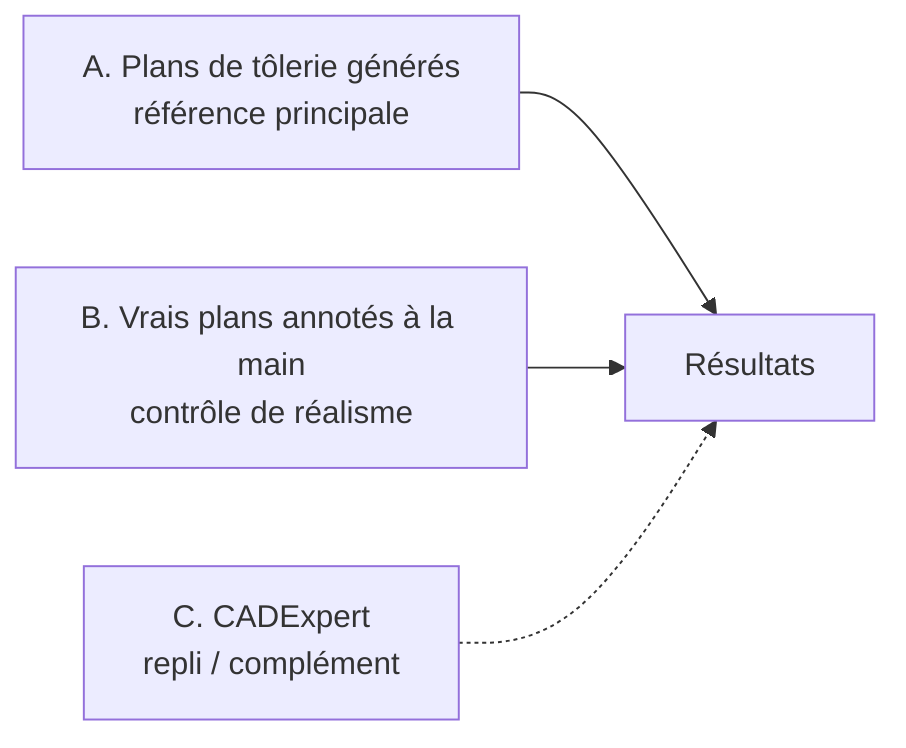
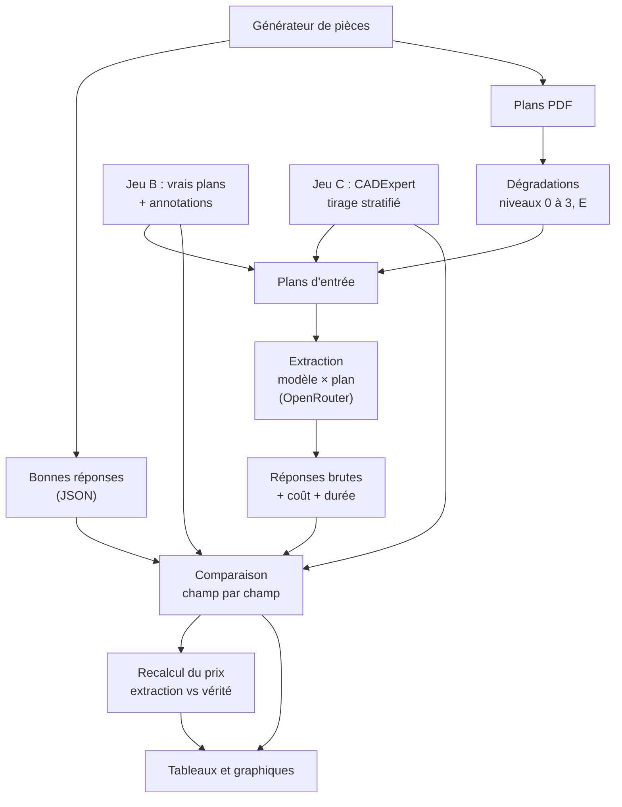

# Évaluation de l'extraction

Ce document décrit le protocole d'évaluation de l'étape d'extraction : à quel point un modèle d'IA lit-il correctement un plan de tôlerie ?

Le projet est découpé en deux parties :
1. **Évaluation de la qualité de l'extraction** (ce document) ;
2. **Création de l'outil de devis** ([architecture.md](architecture.md)).

On commence par l'évaluation, car c'est la seule étape non déterministe de l'outil. C'est elle qui détermine le choix du modèle, la qualité de la V1 et le niveau de vérification humaine nécessaire.

---

## Sommaire

1. [Questions auxquelles on veut répondre](#1-questions-auxquelles-on-veut-répondre)
2. [Ce qui est évalué](#2-ce-qui-est-évalué)
3. [Jeux de données](#3-jeux-de-données)
4. [Découpage développement / test](#4-découpage-développement--test)
5. [Niveaux de dégradation](#5-niveaux-de-dégradation)
6. [Mesures](#6-mesures)
7. [Modèles évalués](#7-modèles-évalués)
8. [Déroulement d'une évaluation](#8-déroulement-dune-évaluation)
9. [Taille des jeux et budget](#9-taille-des-jeux-et-budget)
10. [Restitution des résultats](#10-restitution-des-résultats)
11. [Risques et limites](#11-risques-et-limites)
12. [Plan de travail](#12-plan-de-travail)
13. [Sources](#13-sources)

---

## 1. Questions auxquelles on veut répondre

| # | Question | Pourquoi c'est important |
|---|---|---|
| Q1 | Quel modèle lit le mieux un plan de tôlerie, pour quel coût ? | Choix du fournisseur de la V1 |
| Q2 | Quels champs sont fiables, lesquels ne le sont pas ? | Définir quels champs l'utilisateur doit systématiquement vérifier |
| Q3 | Comment la qualité baisse-t-elle avec un scan ou une photo ? | Savoir si le parcours « photo tablette » est réaliste |
| Q4 | L'IA invente-t-elle des valeurs absentes du plan ? | C'est l'erreur la plus dangereuse : elle ne se voit pas |
| Q5 | Le niveau de confiance annoncé par l'IA est-il fiable ? | Savoir si on peut s'en servir pour orienter la vérification |
| Q6 | Quel est l'impact des erreurs sur le prix final ? | Traduire la qualité en langage métier |
| Q7 | Les résultats sur plans générés se retrouvent-ils sur de vrais plans ? | Ne pas surestimer la qualité réelle |

---

## 2. Ce qui est évalué

La tâche évaluée : **à partir d'un plan (PDF ou image), produire le JSON de la pièce** au format défini dans [architecture.md §9.3](architecture.md#93-format-de-sortie).

Les champs sont regroupés par famille. L'**impact prix** indique à quel point une erreur sur ce champ fausse le devis.

| Famille | Champs | Impact prix |
|---|---|---|
| Identification | référence, désignation | Aucun |
| Matière | matière, nuance, épaisseur | **Fort** (prix au kg, vitesse de coupe, faisabilité) |
| Encombrement | longueur, largeur, hauteur hors-tout | Fort (flan, matière) |
| Profil de pliage | nombre de plis, angles, rayons, longueurs d'ailes | **Fort** (développé, temps de pliage) |
| Contours | trous (diamètre, quantité), oblongs, chanfreins, découpes | Moyen (longueur de coupe, amorçages) |
| Composants | type, filetage, quantité (nomenclature) | Moyen (prix d'achat, sertissage) |
| Traitement | type, zones à épargner | Moyen à fort (minimum de lot) |
| Notes et tolérances | tolérance générale, tolérances particulières, notes de fabrication | Faible à moyen (contrôle, faisabilité) |

Ce qui n'est **pas** évalué ici : la géométrie (calculée par le code), les règles de faisabilité et le prix, qui sont déterministes et testés par des tests classiques.

---

## 3. Jeux de données

Trois jeux complémentaires. Aucun n'utilise de plan client confidentiel.

### 3.1 Jeu A — Plans de tôlerie générés (référence principale)

On génère des pièces de tôlerie avec des paramètres aléatoires réalistes, puis leurs plans. La description de la pièce sert de bonne réponse.

| Élément | Variations |
|---|---|
| Forme | Plaque plate, L, U, Z, chapeau ; 0 à 4 plis parallèles |
| Matière / épaisseur | Matières et épaisseurs de [sources_donnees.md](sources_donnees.md) (1 à 6 mm) |
| Dimensions | Flan de 30 à 500 mm, longueurs d'ailes, rayons de pliage |
| Contours | 0 à 12 trous (Ø 3 à 20 mm), oblongs, chanfreins, rayons d'angle, cotations « 2x » |
| Composants | 0 à 4 écrous ou goujons à sertir, dans une nomenclature REP / désignation / quantité |
| Cartouche | Référence, désignation, matière, épaisseur, traitement, tolérance générale (ISO 2768-m / f / c) |
| Notes | Bilingues FR/EN, sur le modèle de piece_003 : rayon de pliage, rayons non cotés, épargne de peinture, norme de sertissage, ébavurage |
| Mise en page | Format A4 / A3, polices, position des vues et des cotes, présence d'une vue 3D, langue |

Les notes sont importantes : sur piece_003, une bonne partie de l'information qui change le prix (rayon de pliage, écrous à sertir, peinture) est dans le texte et non dans le dessin.

**Production** : la pièce est construite par le module de géométrie de l'outil (modèle 3D + pièce à plat). Le plan (vues de dessus et de côté, lignes de cote, cartouche, notes, nomenclature) est dessiné par du code, puis exporté en PDF vectoriel.

### 3.2 Jeu B — Vrais plans annotés à la main (contrôle de réalisme)

Un petit jeu de vrais plans de tôlerie, annotés à la main selon le même format JSON. Son rôle : vérifier que les scores obtenus sur le jeu A **se retrouvent sur de vrais plans** (question Q7). Si un modèle réussit bien sur A et mal sur B, c'est que nos plans générés sont trop faciles.

Il n'existe pas, à notre connaissance, de jeu public de plans de tôlerie annotés. Sources candidates :

| Source | Contenu | Licence | À vérifier |
|---|---|---|---|
| piece_003 (exercice) | 1 plan réel de support plié | Fourni pour l'exercice | Non versionné dans le dépôt |
| [Sheet Metal PC Case](https://github.com/Varghese-Alen/sheet-metal-pc-case) | Boîtier de PC : 19 pièces pliées (acier 1 et 3 mm, alu 1 et 1,5 mm), PDF de plans de 41 pages, tableau des plis (`bend-schedule.csv`), modèles FreeCAD | CERN-OHL-P-2.0 (permissive) | Présence de cotes et de cartouches dans le PDF |
| [Precious Plastic Shredder Pro](https://community.preciousplastic.com/library/shredder-pro-by-weima-10) | Machine avec pièces découpées laser et pliées, plans PDF | CC BY-SA 4.0 | Contenu exact des plans |
| Mises en plan créées à partir de modèles 3D open source | Mises en plan réalisées avec un vrai logiciel de CAO (FreeCAD TechDraw) à partir des modèles du PC Case | Celle du modèle | Effort de mise en plan |
| Plans fournis par l'entreprise | Plans réels anonymisés | À demander | Accord nécessaire |

La dernière ligne est à poser comme question pendant l'entretien : quelques plans réels anonymisés seraient la meilleure validation possible.

**Objectif** : 10 à 20 plans. C'est trop peu pour un classement fin des modèles, mais suffisant pour détecter un écart important avec le jeu A.

### 3.3 Jeu C — CADExpert (repli / complément)

[CADExpert](https://huggingface.co/datasets/morgan/CADExpert_fixed) (licence Apache-2.0) : 14 935 pièces mécaniques présentées en 3 vues cotées (face, dessus, droite), avec leur modèle CAO de référence (code CadQuery, volume, encombrement).

| Caractéristique | Valeur |
|---|---|
| Découpage | entraînement 10 454 / validation 1 494 / test 2 987 |
| Familles | circulaire (5 000), rectangulaire (4 994), polygonale (4 941) |
| Complexité | score par pièce, sous-ensemble « difficile » de 747 cas dans le test |
| Bonnes réponses | code CadQuery, volume, encombrement, nombre de faces, opérations |

**Limites pour notre cas** :
- pas de plis : ce sont des volumes extrudés avec trous et découpes ;
- pas de cartouche, de notes ni de nomenclature ;
- des formes parfois plus complexes que nos pièces, avec un risque de résultats trop pessimistes **ou** trop optimistes selon les champs.

**Usage prévu** :
1. **Repli** si le jeu A ou le jeu B ne peut pas être constitué à temps.
2. **Complément** pour une question précise : le modèle lit-il correctement les cotes et les trous sur des vues de face, de dessus et de côté ? Les résultats sont présentés **à part**, jamais comme score principal.
3. **Enrichissement** (piste) :
   - Les pièces **de faible épaisseur** (une dimension ≤ 10 mm) correspondent à des **plaques découpées sans pli**, un cas réel de tôlerie. On peut les filtrer et les traiter comme des pièces de tôlerie à 0 pli.
   - On peut **compléter la page** avec un cartouche, des notes et une nomenclature générés : les vues viennent de CADExpert, le reste de notre générateur, et la bonne réponse combine les deux.

Les champs évalués sur CADExpert se limitent à ce que la bonne réponse permet de vérifier : encombrement, épaisseur, trous (nombre, diamètres).

---

## 4. Découpage développement / test

Règle de base : **on ajuste les prompts sur un jeu de développement, et on ne mesure le jeu de test qu'à la fin.** Sinon, on adapte les prompts au test sans s'en rendre compte et les scores sont surestimés.

| Jeu | Développement (ajustement des prompts) | Test (mesure finale) |
|---|---|---|
| A — Générés | 50 pièces (graine aléatoire dédiée) | 200 pièces (autre graine) |
| B — Vrais plans | piece_003 | Tous les autres |
| C — CADExpert | 50 pièces tirées de `validation` | 300 pièces tirées de `test` |

Pour CADExpert, le tirage du test est **stratifié** : même proportion de chaque famille (circulaire, rectangulaire, polygonale) et de chaque tiers de complexité que dans le jeu complet. On peut ainsi présenter les résultats par niveau de complexité.

---

## 5. Niveaux de dégradation

Chaque plan du jeu A (et du jeu B quand c'est possible) est décliné en plusieurs versions :

| Niveau | Description | Paramètres | Ce qu'on teste |
|---|---|---|---|
| 0 | PDF vectoriel propre | — | Lecture du texte PDF + compréhension du dessin |
| 1 | Image du PDF (sans texte lisible) | 200 dpi | Lecture de l'image seule |
| 2 | Scan | 100 – 150 dpi, bruit, rotation ±2°, léger flou, niveaux de gris | Robustesse au scan |
| 3 | Photo | Perspective, ombre, flou de mise au point, reflet, fond visible | Parcours tablette / téléphone |
| E | Plan volontairement erroné | Matière absente, cote manquante, cotes contradictoires, nomenclature incomplète | Signalement du problème ou invention d'une valeur |

Le niveau E se combine avec les niveaux 0 à 3. La bonne réponse attendue pour un champ absent est `null`, et pour une incohérence, un signalement.

---

## 6. Mesures

### 6.1 Règles de comparaison

| Type de champ | Règle |
|---|---|
| Cote numérique | Juste si l'écart ≤ 0,5 mm (ou ≤ 1 % pour les grandes cotes) |
| Angle | Juste si l'écart ≤ 1° |
| Liste (trous, plis, composants) | Appariement des éléments extraits avec les éléments attendus, puis précision et rappel |
| Texte (matière, traitement, notes) | Comparaison après normalisation (majuscules, synonymes : « S235 » = « S235JR », « galva » = « galvanisation ») |
| Champ absent du plan | Juste uniquement si l'IA renvoie `null` |

### 6.2 Indicateurs

| Indicateur | Définition | Question |
|---|---|---|
| **Réponses valides** | Part des réponses conformes au format JSON | Q1 |
| **Exactitude par champ** | Part des champs justes, par famille de champs | Q1, Q2 |
| **Pièces entièrement justes** | Part des plans où tous les champs à impact fort sont justes | Q1, Q2 |
| **Comptage** | Nombre de trous, plis et composants correct | Q2 |
| **Dégradation** | Exactitude par niveau 0 → 3 | Q3 |
| **Taux d'invention** | Part des champs absents pour lesquels l'IA donne quand même une valeur | Q4 |
| **Détection d'incohérence** | Part des plans erronés (niveau E) où l'IA signale le problème | Q4 |
| **Fiabilité de la confiance** | Exactitude par tranche de confiance annoncée (la confiance 0,9 est-elle juste 90 % du temps ?) | Q5 |
| **Écart de prix** | Écart relatif entre le prix calculé à partir de l'extraction et le prix calculé à partir de la bonne réponse (médiane, part des devis à moins de 5 % / 10 %) | Q6 |
| **Écart réel / généré** | Différence d'exactitude entre le jeu B et le jeu A (niveau 0) | Q7 |
| **Coût et durée** | Coût et temps de réponse par plan | Q1 |

L'**écart de prix** est l'indicateur à mettre en avant devant le métier : « dans 85 % des cas, le prix calculé à partir de l'extraction automatique est à moins de 5 % du prix juste ».

### 6.3 Stabilité

Un modèle d'IA ne donne pas toujours la même réponse. Sur un sous-ensemble de 30 plans, chaque modèle est interrogé **3 fois** pour mesurer la part des champs qui changent d'un appel à l'autre. Un champ instable est un champ à faire vérifier.

---

## 7. Modèles évalués

### 7.1 Pas de benchmark public directement utilisable

- Les benchmarks d'OCR ([OmniDocBench](https://www.codesota.com/ocr/benchmark/omnidocbench), [OCRBench v2](https://benchlm.ai/benchmarks/ocrbenchv2), [olmOCR-Bench](https://roboflow.com/blog/best-open-source-ocr-models)) mesurent la lecture de texte dans des documents.
- Lire un plan demande surtout de **comprendre l'espace** : associer une cote au bon élément, relier les vues, compter.
- Les benchmarks sur les plans techniques sont récents et petits : [AECV-Bench](https://arxiv.org/pdf/2601.04819) (architecture et ingénierie), [MechVQA](https://arxiv.org/pdf/2605.30794) (plans mécaniques), [DrawingVQA](https://openaccess.thecvf.com/content/CVPR2026F/papers/Jung_DrawingVQA_A_Real-World_Benchmark_for_Multi-Depth_Visual-Textual_Reasoning_on_Construction_CVPRF_2026_paper.pdf) (plans de construction). Un [benchmark d'éditeur](https://www.businesswaretech.com/blog/benchmark-testing-ai-models-on-engineering-drawings) sur des plans mécaniques place Gemini en tête, mais sans méthodologie publiée.

Ces benchmarks servent donc à **présélectionner** les modèles. C'est notre propre évaluation qui tranche.

### 7.2 Présélection

4 à 6 modèles accessibles via OpenRouter (avec entrée image), répartis en trois catégories :

| Catégorie | Exemples | Intérêt |
|---|---|---|
| Grands modèles | Claude, GPT, Gemini (versions haut de gamme) | Meilleure qualité attendue |
| Modèles économiques | Gemini Flash, Claude Haiku | Compromis qualité / coût |
| Modèle open source | Qwen-VL | Peut être hébergé en interne (confidentialité) |

La liste exacte (identifiants et prix) sera fixée au moment de l'exécution, d'après le catalogue OpenRouter.

### 7.3 Variante à tester : approche mixte

Un modèle OCR spécialisé (PaddleOCR-VL, GLM-OCR…) lit le texte (cotes, cartouche, notes), puis un modèle généraliste interprète le dessin en s'appuyant sur ce texte. Au niveau 0, le texte du PDF joue le même rôle.

### 7.4 Conditions identiques pour tous

- Même prompt et même format de sortie imposé ;
- température à 0 (ou au plus bas autorisé) ;
- même résolution d'image ;
- prompt versionné : chaque résultat est rattaché à la version du prompt utilisée.

---

## 8. Déroulement d'une évaluation

Pour que l'évaluation soit reproductible, chaque exécution enregistre :
- l'identifiant exact du modèle, la date, la version du prompt ;
- la graine du générateur et les paramètres de dégradation ;
- la réponse brute, le coût et la durée de chaque appel.

Les réponses brutes sont stockées localement (`results/`, hors du dépôt). Seuls les résumés sont versionnés.

---

## 9. Taille des jeux et budget

### 9.1 Précision des scores selon le nombre de plans

Pour un taux de réussite autour de 80 %, la marge d'erreur (intervalle de confiance à 95 %) est :

| Nombre de plans | Marge d'erreur |
|---|---|
| 50 | ± 11 points |
| 100 | ± 8 points |
| 300 | ± 4,5 points |
| 500 | ± 3,5 points |
| 1 000 | ± 2,5 points |

300 plans par jeu de test permettent de distinguer des modèles dont l'écart dépasse environ 5 points. Au-delà, le gain de précision coûte cher.

### 9.2 Nombre d'appels

| Jeu | Plans | Versions | Appels par modèle |
|---|---|---|---|
| A — test | 200 | niveaux 0 à 3 (×4) + 50 erronés | ~850 |
| B — test | 10 à 20 | niveaux 0 à 3 quand possible | ~60 |
| C — test | 300 | niveau 1 (images d'origine) | 300 |
| Stabilité | 30 | ×3 | 90 |
| **Total** | | | **~1 300** |

### 9.3 Budget estimé

Ordre de grandeur, à vérifier avec les tarifs OpenRouter au moment de l'exécution :
- grand modèle : environ 0,02 à 0,05 € par plan, soit 25 à 65 € pour l'évaluation complète ;
- modèle économique : 5 à 10 fois moins cher.

Pour 5 modèles, le budget total reste **de l'ordre de 100 à 200 €**. Les itérations sur le jeu de développement (50 plans, un ou deux modèles) coûtent quelques euros chacune.

---

## 10. Restitution des résultats

| Restitution | Contenu | Question |
|---|---|---|
| Tableau de synthèse | Modèle × indicateurs principaux (exactitude, invention, écart de prix, coût) | Q1 |
| Carte de chaleur | Exactitude par famille de champs × modèle | Q2 |
| Courbe de dégradation | Exactitude par niveau (0 → 3), une courbe par modèle | Q3 |
| Graphique qualité / coût | Un point par modèle, pour repérer les meilleurs compromis | Q1 |
| Courbe de confiance | Exactitude réelle par tranche de confiance annoncée | Q5 |
| Distribution de l'écart de prix | Histogramme des écarts relatifs | Q6 |
| Comparaison A / B | Exactitude sur plans générés vs vrais plans | Q7 |
| Exactitude par complexité (CADExpert) | Une courbe par modèle | Complément |
| Galerie d'erreurs | Quelques cas commentés (plan, extraction, bonne réponse) | Illustration |

---

## 11. Risques et limites

| Risque | Conséquence | Réponse |
|---|---|---|
| Plans générés trop « propres » | Scores surestimés | Jeu B de vrais plans, variation de la mise en page, dégradations |
| Générateur et prompt conçus par la même personne | Biais inconscient vers ce que le prompt sait faire | Définir le générateur avant d'écrire le prompt ; jeu B indépendant |
| Ajustement des prompts sur le test | Scores surestimés | Séparation stricte développement / test |
| CADExpert éloigné de la tôlerie | Fausses attentes (trop optimistes ou pessimistes) | Résultats présentés à part, champs limités |
| Annotations manuelles du jeu B erronées | Bruit dans la mesure | Double relecture des annotations |
| Modèles mis à jour par les fournisseurs | Résultats non reproductibles | Enregistrer l'identifiant exact et la date |
| Peu de vrais plans | Conclusions fragiles sur Q7 | Présenter Q7 comme un contrôle, pas comme un score |

---

## 12. Plan de travail

| Étape | Livrable |
|---|---|
| 1. Format de sortie | Schéma JSON de la pièce (Pydantic) |
| 2. Générateur de pièces | Pièces aléatoires + bonnes réponses + modèle 3D / pièce à plat |
| 3. Mise en plan | PDF avec vues, cotes, cartouche, notes, nomenclature |
| 4. Dégradations | Niveaux 1 à 3 et E |
| 5. Jeu B | 10 à 20 vrais plans annotés |
| 6. Jeu C | Chargement et tirage stratifié de CADExpert |
| 7. Exécution | Appels OpenRouter, enregistrement des réponses, coût et durée |
| 8. Comparaison | Calcul des indicateurs |
| 9. Itérations | Ajustement du prompt sur le jeu de développement |
| 10. Mesure finale | Exécution sur les jeux de test, rapport de résultats |

---

## 13. Sources

- [CADExpert (Hugging Face)](https://huggingface.co/datasets/morgan/CADExpert_fixed)
- [Sheet Metal PC Case (GitHub)](https://github.com/Varghese-Alen/sheet-metal-pc-case)
- [Precious Plastic — Shredder Pro](https://community.preciousplastic.com/library/shredder-pro-by-weima-10)
- [TechMB (Hugging Face)](https://huggingface.co/datasets/WSKL/techmb)
- [AECV-Bench](https://arxiv.org/pdf/2601.04819)
- [MechVQA](https://arxiv.org/pdf/2605.30794)
- [DrawingVQA (CVPR 2026)](https://openaccess.thecvf.com/content/CVPR2026F/papers/Jung_DrawingVQA_A_Real-World_Benchmark_for_Multi-Depth_Visual-Textual_Reasoning_on_Construction_CVPRF_2026_paper.pdf)
- [Fine-Tuning VLM for Engineering Drawing Information Extraction](https://arxiv.org/pdf/2411.03707)
- [Businessware — Benchmark: Testing AI Models On Engineering Drawings](https://www.businesswaretech.com/blog/benchmark-testing-ai-models-on-engineering-drawings)
- [OmniDocBench leaderboard](https://www.codesota.com/ocr/benchmark/omnidocbench)
- [OCRBench v2 leaderboard](https://benchlm.ai/benchmarks/ocrbenchv2)
- [Roboflow — Best open-source OCR models 2026](https://roboflow.com/blog/best-open-source-ocr-models)
- [Rapid Protos — Sheet Metal Drawings: Standards, Tolerances & DFM](https://www.rapid-protos.com/sheet-metal-drawings/)
