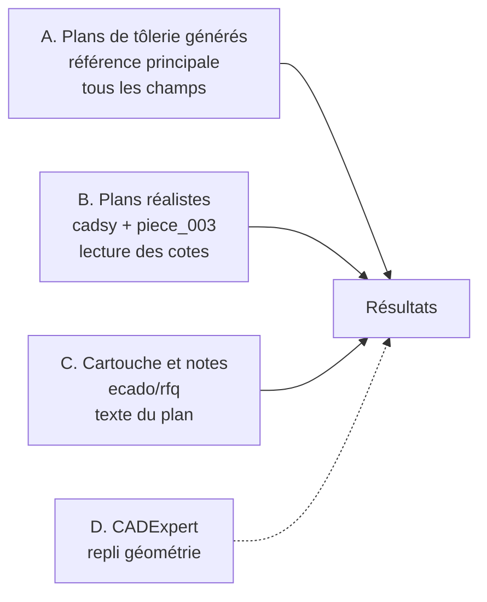
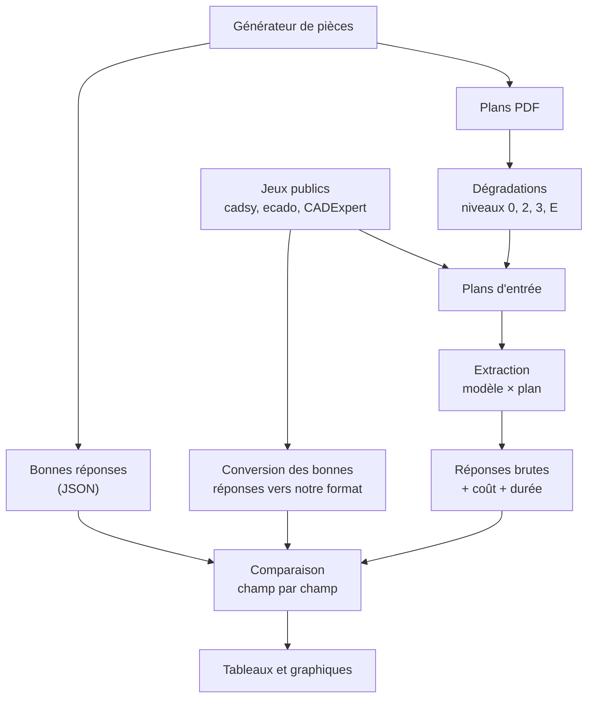

# Évaluation de l'extraction

Ce document décrit le protocole d'évaluation de l'étape d'extraction : à quel point un modèle d'IA lit-il correctement un plan de tôlerie ?

Le projet est découpé en deux parties :
1. **Évaluation de la qualité de l'extraction** (ce document) ;
2. **Création de l'outil de devis** ([architecture.md](architecture.md)).

On commence par l'évaluation, car c'est la seule étape non déterministe de l'outil. C'est elle qui détermine le choix du modèle, la qualité de la V1 et le niveau de vérification humaine nécessaire.

> **Cadre** : exercice d'entretien, budget limité. Le protocole vise des résultats **indicatifs et honnêtes** plutôt qu'un classement fin des modèles. Les marges d'erreur sont donc annoncées explicitement (voir [section 9](#9-taille-des-jeux-et-budget)).

---

## Sommaire

1. [Questions auxquelles on veut répondre](#1-questions-auxquelles-on-veut-répondre)
2. [Ce qui est évalué](#2-ce-qui-est-évalué)
3. [Jeux de données](#3-jeux-de-données)
4. [Découpage développement / test](#4-découpage-développement--test)
5. [Niveaux de dégradation](#5-niveaux-de-dégradation)
6. [Mesures](#6-mesures)
7. [Modèles évalués](#7-modèles-évalués)
8. [Déroulement d'une évaluation](#8-déroulement-dune-évaluation)
9. [Taille des jeux et budget](#9-taille-des-jeux-et-budget)
10. [Restitution des résultats](#10-restitution-des-résultats)
11. [Risques et limites](#11-risques-et-limites)
12. [Plan de travail](#12-plan-de-travail)
13. [Annexe : inventaire des jeux de plans sur Hugging Face](#13-annexe--inventaire-des-jeux-de-plans-sur-hugging-face)
14. [Sources](#14-sources)

---

## 1. Questions auxquelles on veut répondre

| # | Question | Pourquoi c'est important |
|---|---|---|
| Q1 | **Quels champs le modèle lit-il correctement, et lesquels non ?** | Indicateur principal : définit ce que l'utilisateur doit systématiquement vérifier |
| Q2 | Quel modèle choisir, pour quel coût ? | Choix du fournisseur de la V1 |
| Q3 | Comment la qualité baisse-t-elle avec un scan ou une photo ? | Savoir si le parcours « photo tablette » est réaliste |
| Q4 | L'IA invente-t-elle des valeurs absentes du plan ? | C'est l'erreur la plus dangereuse : elle ne se voit pas |
| Q5 | Le niveau de confiance annoncé par l'IA est-il fiable ? | Savoir si on peut s'en servir pour orienter la vérification |
| Q6 | Les résultats sur plans générés se retrouvent-ils sur des plans plus réalistes ? | Ne pas surestimer la qualité réelle |
| Q7 | *(Plus tard, partie 2)* Quel est l'impact des erreurs sur le prix final ? | Traduire la qualité en langage métier |

Q7 demande les tables de prix de la partie 2. Elle n'est **pas nécessaire** pour cette évaluation et sera ajoutée une fois le moteur de chiffrage disponible, en réutilisant les mêmes résultats d'extraction.

---

## 2. Ce qui est évalué

La tâche évaluée : **à partir d'un plan (PDF ou image), produire le JSON de la pièce** au format défini dans [architecture.md §9.3](architecture.md#93-format-de-sortie).

Les champs sont regroupés par famille. La colonne « importance » indique à quel point une erreur sur ce champ fausserait un devis. Elle sert à pondérer la lecture des résultats, pas à calculer un prix.

| Famille | Champs | Importance |
|---|---|---|
| Identification | référence, désignation | Faible |
| Matière | matière, nuance, épaisseur | **Forte** |
| Encombrement | longueur, largeur, hauteur hors-tout | Forte |
| Profil de pliage | nombre de plis, angles, rayons, longueurs d'ailes | **Forte** |
| Contours | trous (diamètre, quantité), oblongs, chanfreins, découpes | Moyenne |
| Composants | type, filetage, quantité (nomenclature) | Moyenne |
| Traitement | type, zones à épargner | Moyenne |
| Notes et tolérances | tolérance générale, tolérances particulières, notes de fabrication | Faible à moyenne |

Ce qui n'est **pas** évalué ici : la géométrie (calculée par le code), les règles de faisabilité et le prix, qui sont déterministes et testés par des tests classiques.

---

## 3. Jeux de données

Aucun jeu n'utilise de plan client confidentiel. Il n'existe pas, à notre connaissance, de jeu public de **plans de tôlerie** annotés (voir l'[inventaire en annexe](#13-annexe--inventaire-des-jeux-de-plans-sur-hugging-face)). On combine donc un jeu généré, spécifique à la tôlerie, avec des jeux publics qui couvrent chacun une partie du problème.

| Jeu | Ce qu'il couvre | Ce qu'il ne couvre pas |
|---|---|---|
| A — Générés | Tous les champs, dont plis, notes, nomenclature, dégradations | Réalisme du rendu |
| B — Réalistes | Rendu de vrai logiciel de CAO, normes ISO / ASME, cotation dense | Plis, matière, nomenclature |
| C — Cartouche et notes | Matière, traitement, tolérances, notes, cartouche | Géométrie (cotes sans lien avec le dessin) |
| D — CADExpert | Cotes et trous sur 3 vues, complexité variée | Plis, texte, cartouche |

### 3.1 Jeu A — Plans de tôlerie générés (référence principale)

On génère des pièces de tôlerie avec des paramètres aléatoires réalistes, puis leurs plans. La description de la pièce sert de bonne réponse.

| Élément | Variations |
|---|---|
| Forme | Plaque plate, L, U, Z, chapeau ; 0 à 4 plis parallèles |
| Matière / épaisseur | Matières et épaisseurs de [sources_donnees.md](sources_donnees.md) (1 à 6 mm) |
| Dimensions | Flan de 30 à 500 mm, longueurs d'ailes, rayons de pliage |
| Contours | 0 à 12 trous (Ø 3 à 20 mm), oblongs, chanfreins, rayons d'angle, cotations « 2x » |
| Composants | 0 à 4 écrous ou goujons à sertir, dans une nomenclature REP / désignation / quantité |
| Cartouche | Référence, désignation, matière, épaisseur, traitement, tolérance générale (ISO 2768-m / f / c) |
| Notes | Bilingues FR/EN, sur le modèle de piece_003 : rayon de pliage, rayons non cotés, épargne de peinture, norme de sertissage, ébavurage |
| Mise en page | Format A4 / A3, polices, position des vues et des cotes, présence d'une vue 3D, langue |

Les notes sont importantes : sur piece_003, une bonne partie de l'information utile au devis (rayon de pliage, écrous à sertir, peinture) est dans le texte et non dans le dessin.

**Production** : la pièce est construite par le module de géométrie de l'outil (modèle 3D + pièce à plat). Le plan (vues de dessus et de côté, lignes de cote, cartouche, notes, nomenclature) est dessiné par du code, puis exporté en PDF vectoriel. Le [rendu de cadsy](#32-jeu-b--plans-réalistes) sert de modèle visuel pour la mise en page.

### 3.2 Jeu B — Plans réalistes

**[cadsy/cad-technical-drawings](https://huggingface.co/datasets/cadsy/cad-technical-drawings)** (Apache-2.0) : 65 pièces mécaniques issues de modèles CAO réels (Zero-to-CAD), chacune mise en plan deux fois (norme ISO et norme ASME), soit **130 plans**.
- Rendu très proche d'un vrai logiciel de CAO : cadre, cartouche, cotes, symboles de perçage, tolérances géométriques, vue 3D.
- Bonne réponse : le texte et la position de chaque annotation (cotes, tolérances, cartouche), plus le modèle STEP.
- Ce qu'on mesure : la **lecture des cotes et annotations** (part des cotes du plan retrouvées par le modèle) et la tolérance générale.
- Limites : pièces usinées, pas de plis, cartouche générique (pas de matière ni de nomenclature).

**piece_003** (exercice) : le seul vrai plan de tôlerie disponible, annoté à la main. Utilisé pour la démonstration et comme contrôle qualitatif.

**Option, si le temps le permet** : vrais plans de projets open source de tôlerie, annotés à la main. Candidats : [Sheet Metal PC Case](https://github.com/Varghese-Alen/sheet-metal-pc-case) (19 pièces pliées, CERN-OHL-P-2.0) et [Precious Plastic Shredder Pro](https://community.preciousplastic.com/library/shredder-pro-by-weima-10) (CC BY-SA 4.0). On peut aussi demander quelques plans anonymisés à l'entreprise pendant l'entretien.

### 3.3 Jeu C — Cartouche et notes

**[ecado/rfq-engineering-drawings](https://huggingface.co/datasets/ecado/rfq-engineering-drawings)** : 600 plans générés pour des demandes de devis (480 / 60 / 60), avec une bonne réponse JSON très proche de notre besoin :
- cartouche (référence, **matière**, révision, échelle, unités) ;
- cotes avec tolérances, tolérances géométriques, états de surface ;
- **traitement**, symboles de soudure, **notes** (dont la quantité).

Limites : les dessins sont simplistes et les cotes n'ont **pas de lien avec la géométrie dessinée**. On n'évalue donc sur ce jeu que le **texte** du plan (cartouche, matière, traitement, notes, tolérances), pas la géométrie. **Aucune licence n'est indiquée** : usage limité à une évaluation interne, avec citation de la source, sans redistribution.

Son format de réponse est une bonne source d'inspiration pour notre propre schéma JSON.

### 3.4 Jeu D — CADExpert (repli géométrie)

[CADExpert](https://huggingface.co/datasets/morgan/CADExpert_fixed) (Apache-2.0) : 14 935 pièces mécaniques en 3 vues cotées, avec leur modèle CAO de référence. Découpage : entraînement 10 454 / validation 1 494 / test 2 987. Trois familles (circulaire, rectangulaire, polygonale) et un score de complexité par pièce.

**Usage** : repli si le jeu A prend trop de temps à construire, ou complément sur la lecture des cotes et des trous, présenté **à part**.

**Pistes d'enrichissement** :
- les pièces **de faible épaisseur** (une dimension ≤ 10 mm) correspondent à des **plaques découpées sans pli**, un vrai cas de tôlerie ;
- on peut **compléter la page** avec un cartouche, des notes et une nomenclature générés : les vues viennent de CADExpert, le reste de notre générateur.

---

## 4. Découpage développement / test

Règle de base : **on ajuste les prompts sur un jeu de développement, et on ne mesure le jeu de test qu'à la fin.** Sinon, on adapte les prompts au test sans s'en rendre compte et les scores sont surestimés.

| Jeu | Développement (ajustement des prompts) | Test (mesure finale) |
|---|---|---|
| A — Générés | 15 pièces (graine aléatoire dédiée) | 50 pièces (autre graine) |
| B — cadsy | 5 pièces (version ISO) | 30 pièces (version ISO) |
| B — piece_003 | piece_003 | — (démonstration) |
| C — ecado | 5 plans de `validation` | 40 plans de `test` |
| D — CADExpert (si utilisé) | 10 pièces de `validation` | 60 pièces de `test`, tirage stratifié par famille et complexité |

Les jeux de développement sont volontairement petits : quelques itérations de prompt suffisent pour cet exercice.

---

## 5. Niveaux de dégradation

Pour limiter le nombre d'appels, on garde **trois niveaux** sur le jeu A, plus les plans volontairement erronés :

| Niveau | Description | Paramètres | Ce qu'on teste |
|---|---|---|---|
| 0 | PDF vectoriel propre | Texte du PDF + image | Situation idéale |
| 2 | Scan | 100 – 150 dpi, bruit, rotation ±2°, léger flou, niveaux de gris | Robustesse au scan |
| 3 | Photo | Perspective, ombre, flou de mise au point, fond visible | Parcours tablette / téléphone |
| E | Plan volontairement erroné | Matière absente, cote manquante, cotes contradictoires | Signalement ou invention d'une valeur |

Le niveau 1 (image d'un PDF propre, sans texte lisible) est l'état d'origine des jeux B, C et D : il est donc couvert sans appel supplémentaire.

Pour un champ absent (niveau E), la bonne réponse attendue est `null`. Pour une incohérence, c'est un signalement.

---

## 6. Mesures

### 6.1 Règles de comparaison

| Type de champ | Règle |
|---|---|
| Cote numérique | Juste si l'écart ≤ 0,5 mm (ou ≤ 1 % pour les grandes cotes) |
| Angle | Juste si l'écart ≤ 1° |
| Liste (trous, plis, composants, cotes) | Appariement des éléments extraits avec les éléments attendus, puis précision et rappel |
| Texte (matière, traitement, notes) | Comparaison après normalisation (majuscules, synonymes : « S235 » = « S235JR », « galva » = « galvanisation ») |
| Champ absent du plan | Juste uniquement si l'IA renvoie `null` |

### 6.2 Indicateurs

**Indicateur principal : exactitude par champ.** C'est lui qui répond à Q1 et qui sera présenté en premier.

| Indicateur | Définition | Question |
|---|---|---|
| **Exactitude par champ** | Part des champs justes, par famille de champs | **Q1** |
| **Pièces entièrement justes** | Part des plans où tous les champs d'importance forte sont justes | Q1 |
| Réponses valides | Part des réponses conformes au format JSON | Q2 |
| Comptage | Nombre de trous, plis et composants correct | Q1 |
| Rappel des cotes | Part des cotes du plan retrouvées (jeux B et D) | Q1, Q6 |
| Dégradation | Exactitude par niveau (0, 2, 3) | Q3 |
| **Taux d'invention** | Part des champs absents pour lesquels l'IA donne quand même une valeur | Q4 |
| Détection d'incohérence | Part des plans erronés où l'IA signale le problème | Q4 |
| Fiabilité de la confiance | Exactitude par tranche de confiance annoncée | Q5 |
| Écart généré / réaliste | Différence d'exactitude sur les champs communs entre A et B | Q6 |
| Coût et durée | Coût et temps de réponse par plan | Q2 |
| *Écart de prix (partie 2)* | *Prix calculé à partir de l'extraction vs à partir de la bonne réponse* | *Q7* |

---

## 7. Modèles évalués

### 7.1 Pas de benchmark public directement utilisable

- Les benchmarks d'OCR ([OmniDocBench](https://www.codesota.com/ocr/benchmark/omnidocbench), [OCRBench v2](https://benchlm.ai/benchmarks/ocrbenchv2), [olmOCR-Bench](https://roboflow.com/blog/best-open-source-ocr-models)) mesurent la lecture de texte dans des documents.
- Lire un plan demande surtout de **comprendre l'espace** : associer une cote au bon élément, relier les vues, compter.
- Les benchmarks sur les plans techniques sont récents et petits : [AECV-Bench](https://arxiv.org/pdf/2601.04819), [MechVQA](https://arxiv.org/pdf/2605.30794), [DrawingVQA](https://openaccess.thecvf.com/content/CVPR2026F/papers/Jung_DrawingVQA_A_Real-World_Benchmark_for_Multi-Depth_Visual-Textual_Reasoning_on_Construction_CVPRF_2026_paper.pdf). Un [benchmark d'éditeur](https://www.businesswaretech.com/blog/benchmark-testing-ai-models-on-engineering-drawings) sur des plans mécaniques place Gemini en tête, sans méthodologie publiée.

Ces benchmarks servent donc à **présélectionner** les modèles. C'est notre propre évaluation qui tranche.

### 7.2 Présélection selon les accès disponibles

On réutilise les accès existants pour limiter les dépenses. **3 modèles**, un par catégorie :

| Catégorie | Accès | Coût marginal | Intérêt |
|---|---|---|---|
| Grand modèle | Abonnement Claude (via Claude Code en mode non interactif) | Inclus dans l'abonnement, limité par les quotas | Qualité haute attendue |
| Modèle économique | OpenRouter (ex. Gemini Flash) | Quelques centimes pour toute l'évaluation | Compromis qualité / coût, candidat réaliste pour la V1 |
| Modèle open source | OpenRouter, modèles gratuits (ex. Qwen-VL) ou Nous Research | Gratuit, avec limites de débit | Peut être hébergé en interne (confidentialité) |

Points à vérifier au moment de l'exécution :
- les modèles **gratuits** d'OpenRouter ont des limites d'appels par jour, et leurs requêtes peuvent être conservées par le fournisseur (sans conséquence ici : aucun plan confidentiel) ;
- la disponibilité d'un modèle **avec entrée image** sur l'abonnement Nous Research ;
- les quotas de l'abonnement Claude pour ~250 appels avec images.

L'adaptateur de fournisseur ([architecture.md §9.2](architecture.md#92-adaptateur-de-fournisseur)) permet de passer de l'un à l'autre sans changer le code d'évaluation.

### 7.3 Conditions identiques pour tous

- Même prompt et même format de sortie imposé ;
- température à 0 (ou au plus bas autorisé) ;
- même résolution d'image ;
- prompt versionné : chaque résultat est rattaché à la version du prompt utilisée.

### 7.4 Hors périmètre (budget)

- Comparaison d'un plus grand nombre de modèles ;
- approche mixte (OCR spécialisé + modèle généraliste) ;
- mesure de stabilité (plusieurs appels sur le même plan).

Ces pistes sont mentionnées comme suites possibles.

---

## 8. Déroulement d'une évaluation

Pour que l'évaluation soit reproductible, chaque exécution enregistre :
- l'identifiant exact du modèle, la date, la version du prompt ;
- la graine du générateur et les paramètres de dégradation ;
- la réponse brute, le coût et la durée de chaque appel.

Les réponses brutes sont stockées localement (`results/`, hors du dépôt). Seuls les résumés sont versionnés. Une réponse déjà obtenue n'est **jamais redemandée** (mise en cache), pour ne pas payer deux fois.

---

## 9. Taille des jeux et budget

### 9.1 Nombre d'appels

| Jeu | Plans | Versions | Appels par modèle |
|---|---|---|---|
| A — test | 50 | niveaux 0, 2, 3 (×3) + 15 erronés | 165 |
| B — cadsy test | 30 | — | 30 |
| C — ecado test | 40 | — | 40 |
| **Total test** | | | **~235** |
| Développement (tous jeux) | ~25 | 2 à 3 itérations | ~60 |
| D — CADExpert (optionnel) | 60 | — | +60 |

Soit environ **300 appels par modèle**, 900 pour les 3 modèles.

### 9.2 Budget estimé

| Modèle | Coût estimé |
|---|---|
| Grand modèle (abonnement Claude) | 0 € supplémentaire (quotas de l'abonnement) |
| Modèle économique (OpenRouter) | < 2 € |
| Modèle open source gratuit | 0 € |
| **Total** | **< 5 €** |

Ordre de grandeur à confirmer avec les tarifs au moment de l'exécution.

### 9.3 Précision attendue

Avec ces tailles, les scores sont **indicatifs**. Pour un taux de réussite autour de 80 %, la marge d'erreur (intervalle de confiance à 95 %) est :

| Nombre d'observations | Marge d'erreur |
|---|---|
| 30 | ± 14 points |
| 50 | ± 11 points |
| 150 | ± 6,5 points |

Conséquences pour la lecture des résultats :
- on pourra conclure sur les **grands écarts** (un champ lu à 95 % contre un champ lu à 50 %, un modèle nettement meilleur qu'un autre) ;
- on ne conclura **pas** sur des écarts de quelques points entre modèles ;
- certains indicateurs s'appuient sur beaucoup plus d'observations que de plans : par exemple, 50 plans avec 6 trous chacun donnent 300 trous pour mesurer la lecture des diamètres.

Les intervalles de confiance seront affichés sur tous les graphiques.

---

## 10. Restitution des résultats

| Restitution | Contenu | Question |
|---|---|---|
| **Carte de chaleur** | Exactitude par famille de champs × modèle | **Q1** |
| Tableau de synthèse | Modèle × indicateurs principaux (exactitude, invention, coût) | Q1, Q2 |
| Courbe de dégradation | Exactitude par niveau (0, 2, 3), une courbe par modèle | Q3 |
| Graphique qualité / coût | Un point par modèle | Q2 |
| Courbe de confiance | Exactitude réelle par tranche de confiance annoncée | Q5 |
| Comparaison A / B / C | Exactitude sur les champs communs selon le jeu | Q6 |
| Galerie d'erreurs | Quelques cas commentés (plan, extraction, bonne réponse) | Illustration |

---

## 11. Risques et limites

| Risque | Conséquence | Réponse |
|---|---|---|
| Petits échantillons | Écarts faibles non significatifs | Intervalles de confiance affichés, conclusions limitées aux grands écarts |
| Plans générés trop « propres » | Scores surestimés | Jeux B et C, variation de la mise en page, dégradations |
| Générateur et prompt conçus par la même personne | Biais vers ce que le prompt sait faire | Définir le générateur avant d'écrire le prompt ; jeux publics indépendants |
| Ajustement des prompts sur le test | Scores surestimés | Séparation stricte développement / test |
| Jeux publics éloignés de la tôlerie | Fausses attentes | Seuls les champs pertinents sont évalués sur chaque jeu, résultats présentés par jeu |
| Licence absente (ecado) | Risque juridique en cas de diffusion | Usage interne d'évaluation uniquement, sans redistribution |
| Modèles mis à jour par les fournisseurs | Résultats non reproductibles | Enregistrer l'identifiant exact et la date |
| Quotas des abonnements et modèles gratuits | Exécution interrompue | Mise en cache des réponses, reprise possible |

---

## 12. Plan de travail

| Étape | Livrable |
|---|---|
| 1. Format de sortie | Schéma JSON de la pièce (Pydantic), inspiré du format d'ecado |
| 2. Accès aux modèles | Adaptateur commun : Claude Code (abonnement), OpenRouter, Nous Research |
| 3. Jeux publics | Chargement de cadsy et ecado, conversion des bonnes réponses vers notre format |
| 4. Générateur de pièces | Pièces aléatoires + bonnes réponses + modèle 3D / pièce à plat |
| 5. Mise en plan | PDF avec vues, cotes, cartouche, notes, nomenclature |
| 6. Dégradations | Niveaux 2, 3 et E |
| 7. Comparaison | Calcul des indicateurs et intervalles de confiance |
| 8. Itérations | Ajustement du prompt sur le jeu de développement |
| 9. Mesure finale | Exécution sur les jeux de test, rapport de résultats |

Les étapes 2 et 3 peuvent produire de premiers résultats sur des plans publics **avant** que le générateur soit terminé.

---

## 13. Annexe : inventaire des jeux de plans sur Hugging Face

Recherche effectuée le 8 novembre 2026 (mots-clés : *engineering drawing*, *technical drawing*, *mechanical drawing*, *cad drawing*, *blueprint*, *sheet metal*, *orthographic*, *title block*).

| Jeu | Contenu | Licence | Verdict |
|---|---|---|---|
| [cadsy/cad-technical-drawings](https://huggingface.co/datasets/cadsy/cad-technical-drawings) | 130 plans ISO / ASME réalistes générés depuis 65 modèles CAO, annotations positionnées, STEP | Apache-2.0 | **Retenu (jeu B)** |
| [ecado/rfq-engineering-drawings](https://huggingface.co/datasets/ecado/rfq-engineering-drawings) | 600 plans générés pour devis, JSON cartouche / matière / traitement / notes / tolérances | Non indiquée | **Retenu (jeu C)**, usage interne |
| [morgan/CADExpert_fixed](https://huggingface.co/datasets/morgan/CADExpert_fixed) | 14 935 pièces en 3 vues cotées + code CadQuery | Apache-2.0 | **Repli (jeu D)** |
| [jcrzd/engineering-drawings-as1100](https://huggingface.co/datasets/jcrzd/engineering-drawings-as1100) | 210 plans avec défauts de conformité à la norme australienne AS1100 | CC-BY-4.0 | Piste pour la détection de plans incomplets (niveau E) |
| [gregoryS/mechanical-drawing-bom-synthetic](https://huggingface.co/datasets/gregoryS/mechanical-drawing-bom-synthetic) | 500 plans générés simples avec nomenclature et matière | Non indiquée | Non retenu (très simpliste) |
| [AdityaJoglekar/Ortho2CAD_Orthographic_Drawings](https://huggingface.co/datasets/AdityaJoglekar/Ortho2CAD_Orthographic_Drawings) | Vues orthographiques → code CadQuery | Non indiquée | Non retenu (même usage que CADExpert, sans cotes vérifiées) |
| [IHateStats/Title-Block-Engineering-Docs](https://huggingface.co/datasets/IHateStats/Title-Block-Engineering-Docs) | Détection de zones de cartouche (documents chinois) | Non indiquée | Non retenu |
| [alex-novineer/blueprint2cad](https://huggingface.co/datasets/alex-novineer/blueprint2cad), [useKled/technical-drawings](https://huggingface.co/datasets/useKled/technical-drawings) | Accès restreint | CC-BY-4.0 / autre | Non examinés |
| Beifengdo/*, Vasanthaleela/*, utkarsha2/* | Supports de cours, images sans annotations | Non indiquée | Non retenus |

Aucun jeu ne porte spécifiquement sur la **tôlerie** (plis, développé, sertissage), ce qui justifie le jeu A généré.

---

## 14. Sources

- [cadsy/cad-technical-drawings](https://huggingface.co/datasets/cadsy/cad-technical-drawings)
- [ecado/rfq-engineering-drawings](https://huggingface.co/datasets/ecado/rfq-engineering-drawings)
- [CADExpert](https://huggingface.co/datasets/morgan/CADExpert_fixed)
- [Engineering Drawings AS1100](https://huggingface.co/datasets/jcrzd/engineering-drawings-as1100)
- [Sheet Metal PC Case (GitHub)](https://github.com/Varghese-Alen/sheet-metal-pc-case)
- [Precious Plastic — Shredder Pro](https://community.preciousplastic.com/library/shredder-pro-by-weima-10)
- [AECV-Bench](https://arxiv.org/pdf/2601.04819)
- [MechVQA](https://arxiv.org/pdf/2605.30794)
- [DrawingVQA (CVPR 2026)](https://openaccess.thecvf.com/content/CVPR2026F/papers/Jung_DrawingVQA_A_Real-World_Benchmark_for_Multi-Depth_Visual-Textual_Reasoning_on_Construction_CVPRF_2026_paper.pdf)
- [Fine-Tuning VLM for Engineering Drawing Information Extraction](https://arxiv.org/pdf/2411.03707)
- [Businessware — Benchmark: Testing AI Models On Engineering Drawings](https://www.businesswaretech.com/blog/benchmark-testing-ai-models-on-engineering-drawings)
- [OmniDocBench leaderboard](https://www.codesota.com/ocr/benchmark/omnidocbench)
- [OCRBench v2 leaderboard](https://benchlm.ai/benchmarks/ocrbenchv2)
- [Roboflow — Best open-source OCR models 2026](https://roboflow.com/blog/best-open-source-ocr-models)
