# Jeux de test : composition et exemples

Ce que contiennent les jeux de test utilisés dans [resultats.md](resultats.md), avec des exemples en image. Le protocole est décrit dans [evaluation.md](evaluation.md).

---

## 1. Composition

### Plans de tôlerie générés (jeu A) : 50 plans

| Forme | Plis | Plans |
|---|---|---|
| Plaque | 0 | 6 |
| L | 1 | 18 |
| U | 2 | 11 |
| Z | 2 | 10 |
| Chapeau | 4 | 5 |

Tous les plis sont à 90° ; le rayon de pliage est donné en note sur 38 plans.

| Élément | Plans concernés | Total |
|---|---|---|
| Trous (tous ronds) | 34 | 67 trous |
| Coins coupés | 27 | 21 rayons, 9 chanfreins |
| Écrous ou goujons à sertir | 13 | 24 composants |
| Épaisseur | 50 | |
| Matière | 47 | 3 volontairement absentes |
| Traitement | 43 | dont 3 avec zone d'épargne |
| Tolérance générale | 39 | |
| Notes | 48 | 123 notes |
| Cotes | 50 | 339 cotes |

Langue : 28 plans en français, 22 en anglais. Le jeu A ne contient ni soudure, ni tolérance géométrique, ni état de surface : ces champs sont mesurés sur les jeux publics.

Chaque plan est lu trois fois : PDF propre, scan, photo (150 lectures).

### Plans erronés et incohérents

| Jeu | Plans | Contenu |
|---|---|---|
| Plans erronés (niveau E) | 16 | 4 types × 4 plans : matière absente, épaisseur absente, cote d'aile manquante, cotes contradictoires |
| Plans incohérents | 12 | 3 types × 4 plans : quantité de trous fausse, trou coté hors de la pièce, traitement impossible sur la matière |

### Jeux publics

| | cadsy (30 plans) | ecado (40 plans) |
|---|---|---|
| Type de plan | Rendu CAO réaliste, cotation dense (ISO / ASME) | Plan de devis : cartouche, matière, traitement, notes |
| Cotes | 368 | 228 |
| Tolérances géométriques | 29 plans | 30 plans |
| Tolérance générale | 30 plans | 10 plans |
| Matière, traitement | — | 40 plans |
| Soudures | — | 26 plans |
| États de surface | — | 40 plans |
| Plis, trous, composants | non annotés | non annotés |

### Ce que ça implique

- Les **pièces à 4 plis** (5 plans) sont celles qui départagent les modèles : l'écart est net mais mesuré sur peu de plans.
- La **zone d'épargne** (3 plans) n'a pas assez de cas pour un score exploitable.
- **piece_003** est le seul vrai plan de tôlerie disponible. Tous les autres plans de tôlerie sont générés : plus réguliers que de vrais plans (mise en page, polices, cotation complète). Les scores du jeu A sont un **plafond**, pas une prévision.

---

## 2. Niveaux de qualité

Le même plan (test-021, chapeau à 4 plis) aux trois niveaux. Les dégradations sont simulées par [degradations.py](../src/generateur_devis/evaluation/degradations.py).

**PDF propre** : image + texte du PDF fournis au modèle.

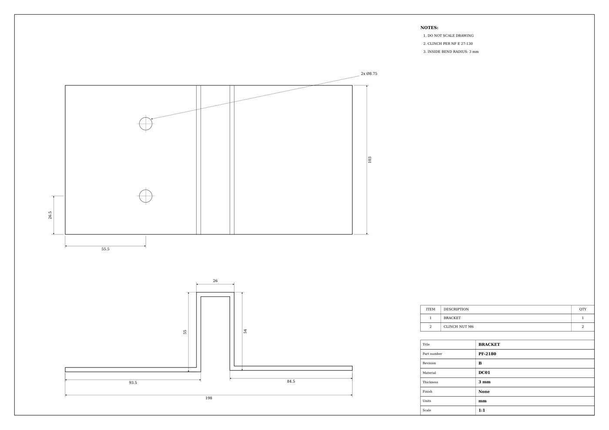

**Scan** : niveaux de gris, 100 – 150 dpi, rotation ±2°, flou léger, bruit et poussières, compression JPEG. Le texte du PDF n'est plus fourni.

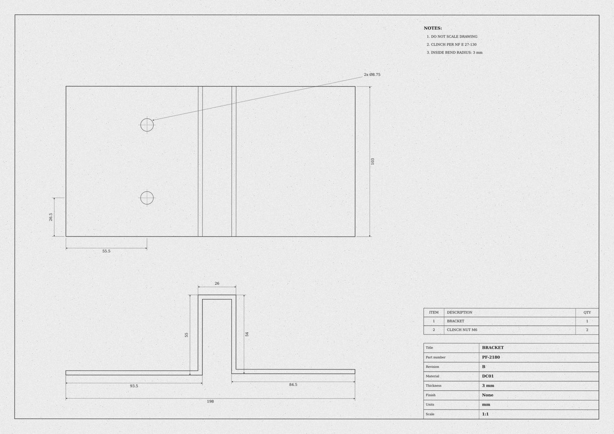

**Photo** : perspective, fond visible, éclairage inégal, papier teinté, flou, compression JPEG.

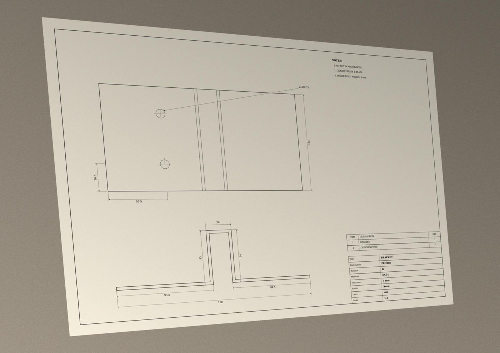

**Zoom sur le cartouche** (PDF, scan, photo) :

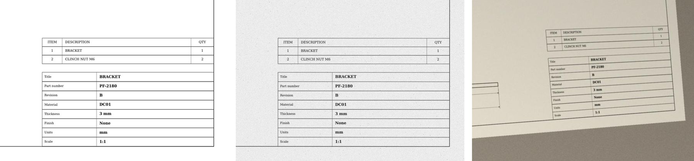

Limites de la simulation : pas de pliure du papier, de reflet, d'annotation manuscrite, de photo partielle ni de plan photocopié plusieurs fois. Une vraie photo d'atelier sera souvent plus dure à lire.

---

## 3. Plans erronés (niveau E)

L'IA doit **signaler** le problème au lieu d'inventer une valeur.

**Matière absente** : « — » dans le cartouche.

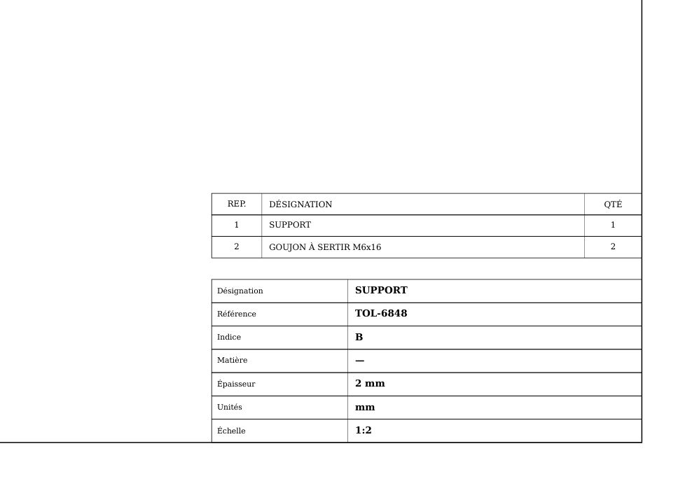

**Épaisseur absente** : « — » dans le cartouche.

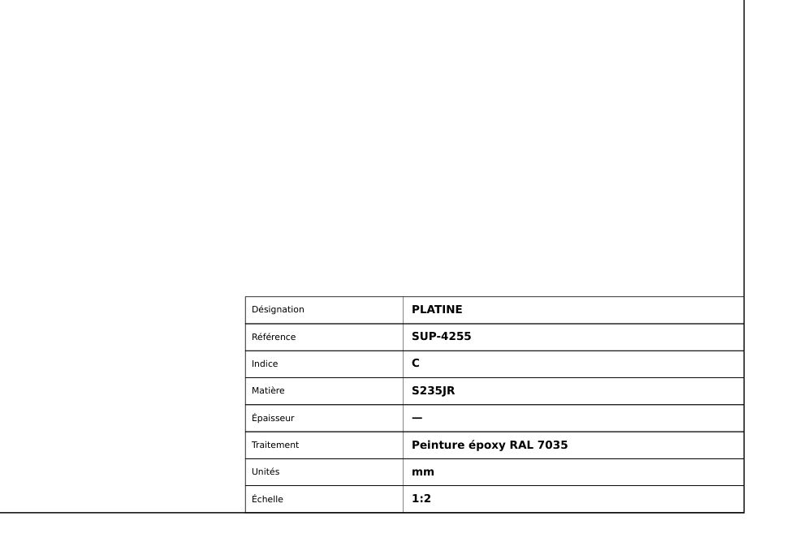

**Cote d'aile manquante** : sur cette équerre en L, seule l'aile verticale est cotée (97,5) ; l'aile horizontale n'a pas de cote et aucune cote d'encombrement ne permet de la retrouver (la vue de dessus ne donne que la largeur 46 et la position du trou). Un modèle qui mesure le dessin à l'échelle invente une valeur.

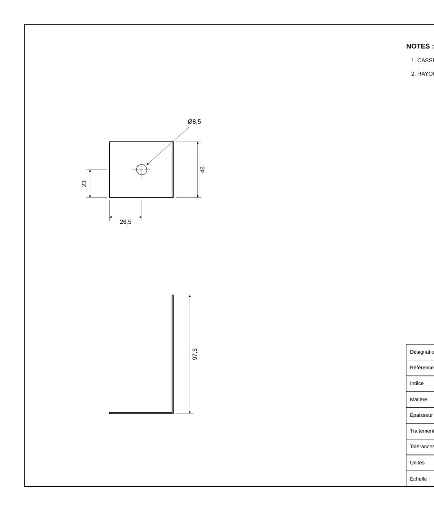

**Cotes contradictoires** : l'aile horizontale du L est cotée 120,5 et, juste en dessous, la longueur hors-tout est cotée 140,5 entre les mêmes lignes d'attache. La pièce ne peut pas mesurer les deux.

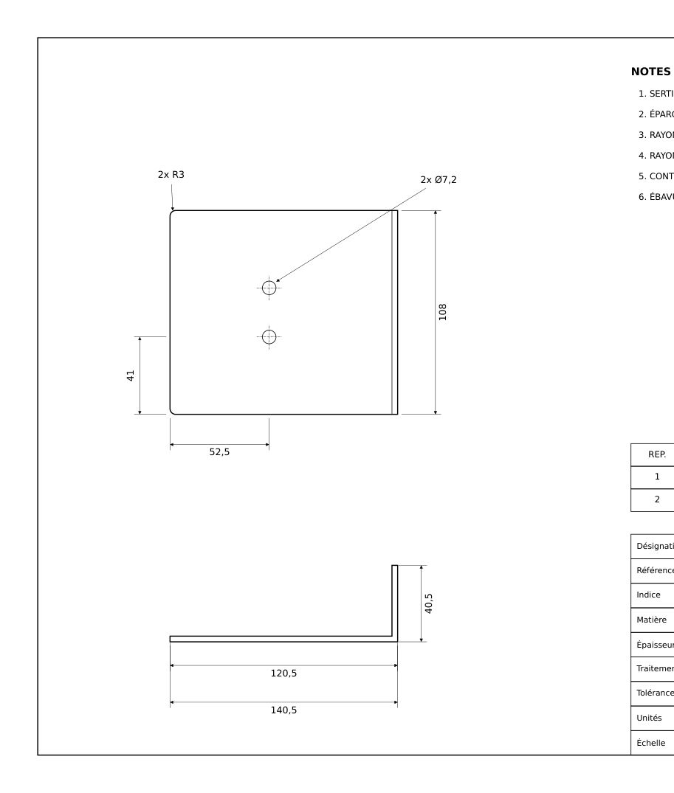

---

## 4. Plans incohérents

Informations lisibles mais invraisemblables : il faut un raisonnement (comparer deux informations, connaître le métier) pour les repérer.

**Quantité de trous fausse** : le rappel annonce « 3x Ø5,4 », mais seuls 2 trous sont dessinés.

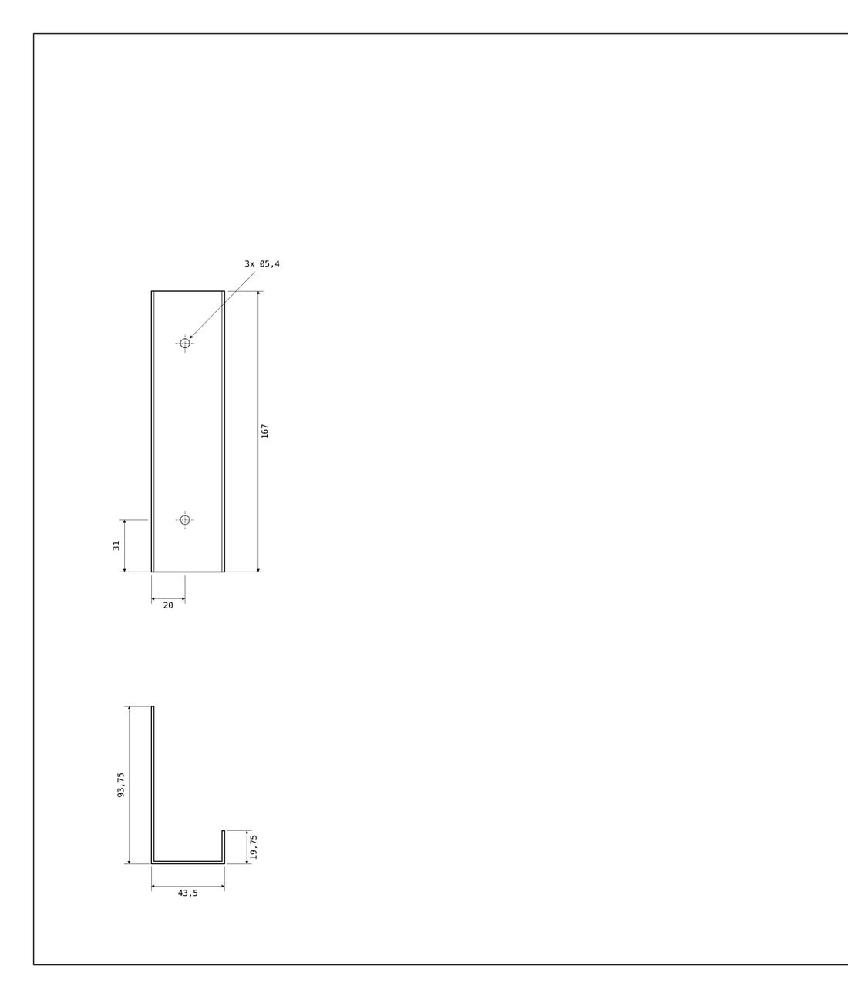

**Trou coté hors de la pièce** : le trou est positionné à 178 du bord, sur une plaque de 126 de large.

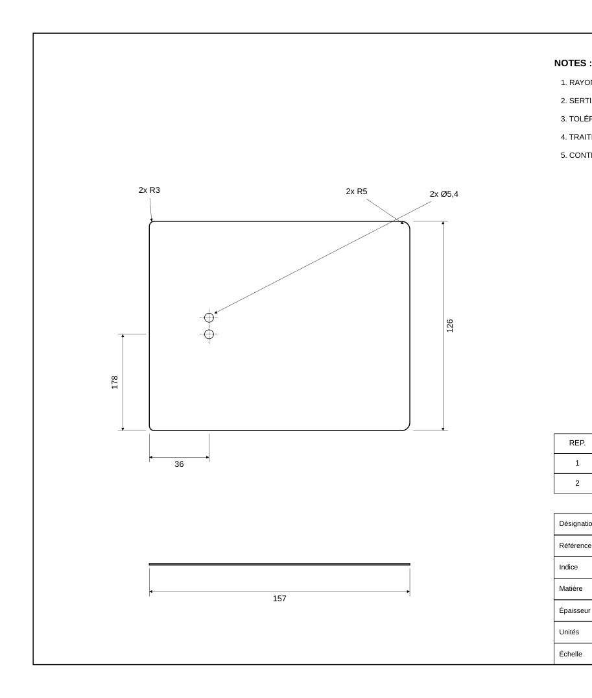

**Traitement impossible** : anodisation (réservée à l'aluminium) sur une pièce en acier. Seuls des cas impossibles sont utilisés : anodisation sur acier ou inox, galvanisation à chaud sur aluminium ou inox.

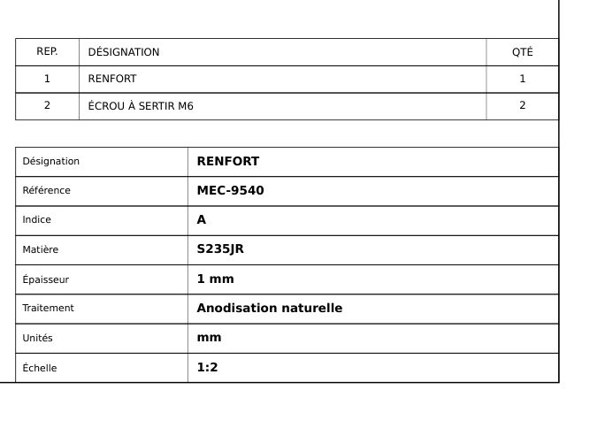
