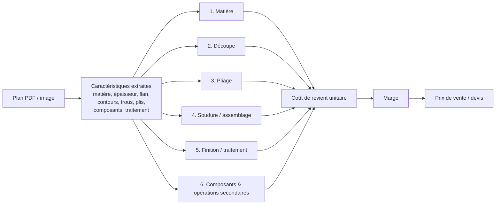

# Logique métier — Chiffrage d'une pièce de tôlerie

Ce guide explique comment on calcule le prix d'une pièce de tôlerie à partir de son plan. Il sert de référence pour le moteur de calcul de l'outil de devis.

Le principe tient en une phrase : **on décompose la fabrication en 6 blocs de coût, on valorise chaque bloc (temps × taux horaire, ou quantité × prix unitaire), on répartit les réglages sur la quantité, puis on applique la marge.**

> Les valeurs chiffrées de ce document sont des **hypothèses simulées**, construites à partir d'ordres de grandeur publics (voir [Sources](#11-sources)). Elles sont toutes paramétrables et devront être calibrées avec les données réelles d'une usine.

---

## Sommaire

1. [Vue d'ensemble](#1-vue-densemble)
2. [Notions transverses](#2-notions-transverses)
3. [Les 6 blocs de coût](#3-les-6-blocs-de-coût)
4. [Du coût au prix de vente](#4-du-coût-au-prix-de-vente)
5. [Effet quantité](#5-effet-quantité)
6. [Contrôles de cohérence](#6-contrôles-de-cohérence)
7. [Paramètres modifiables et valeurs par défaut](#7-paramètres-modifiables-et-valeurs-par-défaut)
8. [Exemple complet : piece_003](#8-exemple-complet--piece_003)
9. [Extension à l'usinage](#9-extension-à-lusinage)
10. [Limites et hypothèses](#10-limites-et-hypothèses)
11. [Sources](#11-sources)

---

## 1. Vue d'ensemble



La formule générale :

```
Coût unitaire = Σ (pour chaque bloc)  [ coût variable par pièce  +  coût de réglage ÷ quantité ]

Prix unitaire = Coût unitaire ÷ (1 − taux de marge)
```

Chaque bloc a la même structure :

| Élément | Définition | Dépend de la quantité ? |
|---|---|---|
| **Coût variable** | Ce que coûte chaque pièce : matière, temps de cycle, composants | Non (coût par pièce constant) |
| **Coût de réglage** | Ce que coûte le lancement de la série : programmation, montage d'outils, première pièce | Oui (réparti sur le lot) |

Un bloc qui ne concerne pas la pièce vaut simplement 0 (par exemple, pas de soudure sur une pièce pliée simple).

---

## 2. Notions transverses

### 2.1 Taux horaire machine (« taux chargé »)

Tout le temps passé sur une machine est valorisé par un taux horaire en €/h. Ce taux couvre l'ensemble des charges liées au poste :

```
Taux horaire = (amortissement + énergie + gaz/consommables + maintenance
                + opérateur + quote-part frais de structure) ÷ heures productives par an
```

Dans l'outil, on manipule directement le taux final par poste (laser, plieuse, poste de sertissage…). Il est donc **déjà chargé** : pas besoin de rajouter des frais de structure par-dessus, sauf si on veut les isoler.

### 2.2 Temps de cycle vs temps de réglage

- **Temps de cycle** : temps machine pour produire **une** pièce (couper un contour, faire un pli). Il est payé à chaque pièce.
- **Temps de réglage** : temps pour **préparer** la machine pour une série (programme CN, outils de pliage, première pièce bonne, contrôle). Il est payé **une fois par lot**.

C'est cette distinction qui explique pourquoi une pièce coûte 80 € à l'unité et 3 € par 100.

### 2.3 Calepinage (nesting) et rendement matière

Les pièces sont découpées dans des formats de tôle standards (ex. 3000 × 1500 mm). On ne peut jamais utiliser 100 % de la tôle : il y a des espaces entre pièces, des bords, des chutes. Le **rendement de calepinage** (typiquement 70–85 %) traduit cette perte :

```
Matière achetée = Matière du flan ÷ rendement
```

### 2.4 Flan développé

Une pièce pliée est découpée **à plat** avant pliage. Il faut donc reconstituer ses dimensions dépliées (le « développé ») à partir des cotes du plan :

```
Longueur développée = Σ longueurs des ailes (cotes intérieures) + Σ BA

BA (bend allowance) = π × angle / 180 × (R + K × e)
    R = rayon intérieur de pliage, e = épaisseur, K = facteur neutre (0,33 – 0,45 ; défaut 0,40)
```

Variante avec cotes extérieures : `Σ cotes extérieures − Σ BD`, avec `BD = 2 × (R + e) × tan(angle/2) − BA`.

---

## 3. Les 6 blocs de coût

### Bloc 1 — Matière

**Ce que c'est** : la tôle consommée par la pièce, y compris la part de chutes.

**Données d'entrée (plan)** : matière, nuance, épaisseur, dimensions du flan développé.

**Formule** :

```
Masse flan (kg)   = L_flan × l_flan × e × densité
Coût matière      = Masse flan ÷ rendement calepinage × prix matière (€/kg)
```

On prend le **rectangle englobant du flan**, pas la surface nette : les trous et chanfreins partent en chute de toute façon.

**Valeurs par défaut** :

| Matière | Densité (kg/dm³) | Prix (€/kg) |
|---|---|---|
| Acier S235 / DC01 | 7,85 | 1,10 |
| Inox 304L | 7,90 | 4,00 |
| Aluminium 5754 | 2,66 | 4,80 |

Rendement calepinage : **0,80**.

**Pièges** : matière non renseignée sur le plan (fréquent), confusion entre masse brute et masse finie, prix matière qui varie avec les cours.

---

### Bloc 2 — Découpe (laser, poinçonnage, plasma)

**Ce que c'est** : le temps machine pour découper le contour extérieur et tous les contours intérieurs (trous, lumières).

**Données d'entrée (plan)** : périmètre extérieur du flan, nombre et dimensions des trous et découpes, matière, épaisseur.

**Formule** :

```
Longueur de coupe = périmètre extérieur + Σ périmètres intérieurs
Nb amorçages      = 1 (contour extérieur) + nb de contours intérieurs
Temps de cycle    = Longueur de coupe ÷ vitesse de coupe + Nb amorçages × temps par amorçage
Coût variable     = Temps de cycle × taux laser
Coût de réglage   = Temps de programmation/réglage × taux laser
```

**Valeurs par défaut** (laser fibre ~3 kW) :

| Paramètre | Valeur |
|---|---|
| Taux laser | 120 €/h |
| Vitesse de coupe effective, acier 2 mm | 5 m/min |
| Temps par amorçage (perçage + déplacement) | 1 s |
| Réglage + programmation | 15 min / lot |

La vitesse dépend fortement de la matière et de l'épaisseur. Elle doit être fournie par une **table vitesse (matière × épaisseur)** propre à la machine.

**Pièges** : une pièce avec beaucoup de petits trous coûte bien plus cher qu'une pièce de même surface avec peu de trous. Le nombre d'amorçages pèse autant que la longueur.

---

### Bloc 3 — Pliage

**Ce que c'est** : le temps de presse plieuse pour réaliser chaque pli.

**Données d'entrée (plan)** : nombre de plis, angles, rayon de pliage, longueur des plis, épaisseur.

**Formule** :

```
Temps de cycle    = Nb plis × temps par pli (+ retournements de pièce)
Coût variable     = Temps de cycle × taux plieuse
Coût de réglage   = Temps de réglage (montage outils, 1re pièce) × taux plieuse
```

**Valeurs par défaut** :

| Paramètre | Valeur |
|---|---|
| Taux plieuse CN | 70 €/h |
| Temps par pli (petite pièce < 300 mm) | 8 s |
| Temps par pli (pièce moyenne / lourde) | 15 – 30 s |
| Réglage | 20 min / lot |

**Pièges** : le tarif forfaitaire « au pli » fait perdre de l'argent sur les grandes pièces et les pièces épaisses. Il faut moduler le temps par pli selon la taille ou le poids de la pièce. Des plis très proches (pli en Z) peuvent demander un outillage spécifique.

---

### Bloc 4 — Soudure / assemblage

**Ce que c'est** : l'assemblage de plusieurs éléments par soudure (MIG, TIG, points) ou rivetage, avec la préparation et la reprise.

**Données d'entrée (plan)** : symboles de soudure, longueur des cordons, nombre de points, nombre de sous-ensembles.

**Formule** :

```
Temps de cycle  = Longueur cordons ÷ vitesse de soudage + nb points × temps par point
                  + temps de pointage / préparation / meulage
Coût variable   = Temps de cycle × taux soudeur
Coût de réglage = Temps de mise en position (gabarit) × taux soudeur
```

**Valeurs par défaut** :

| Paramètre | Valeur |
|---|---|
| Taux soudeur | 60 €/h |
| Vitesse de soudage MIG | 0,3 m/min |
| Préparation + meulage | +50 % du temps d'arc |
| Réglage | 15 min / lot |

Ce bloc vaut **0** pour une pièce unique découpée et pliée.

---

### Bloc 5 — Finition / traitement de surface

**Ce que c'est** : peinture, thermolaquage, cataphorèse, galvanisation, zingage, passivation…

**Données d'entrée (plan)** : traitement demandé, surface de la pièce, zones à épargner (ex. « no paint on threading »).

**Formule** :

```
Surface traitée = 2 × surface nette du flan (deux faces)
Coût lot        = max( Surface traitée × prix au m² × quantité ,  minimum de lot )
Coût unitaire   = Coût lot ÷ quantité
```

**Valeurs par défaut** :

| Traitement | Prix | Minimum de lot |
|---|---|---|
| Peinture poudre (1 couche) | 35 €/m² | 80 € |
| Zingage | 15 €/m² | 60 € |
| Masquage / épargne | +0,10 €/zone | — |

Le traitement est souvent **sous-traité**. Le minimum de lot domine alors complètement en petite série.

---

### Bloc 6 — Composants achetés & opérations secondaires

**Ce que c'est** : tout ce qui est ajouté à la pièce après découpe et pliage :
- **composants achetés** : écrous à sertir, goujons, inserts, rivets, joints ;
- **opérations secondaires** : sertissage, taraudage, ébavurage, fraisurage, marquage, contrôle.

**Données d'entrée (plan)** : nomenclature (tableau REP / QTY), notes (taraudages, normes de sertissage), tolérances serrées qui imposent un contrôle.

**Formule** :

```
Coût composants   = Σ (quantité × prix unitaire)
Coût opérations   = Σ (nb opérations × temps par opération) × taux du poste
Coût de réglage   = Σ temps de réglage des postes × taux
```

**Valeurs par défaut** :

| Élément | Valeur |
|---|---|
| Écrou à sertir M6 acier | 0,20 € pièce |
| Pose d'un écrou à sertir | 12 s |
| Taraudage d'un trou | 20 s |
| Ébavurage (petite pièce) | 10 s |
| Taux poste manuel / sertisseuse | 50 €/h |
| Réglage sertisseuse | 10 min / lot |

### Correspondance avec le format de la pièce

Chaque bloc s'appuie sur des champs lus sur le plan ([format de la pièce](../src/generateur_devis/schema/piece.py)). Le reste (surface du flan, longueur de coupe, masse…) est **calculé par le code**, jamais par l'IA.

| Bloc | Champs lus sur le plan | Calculé par le code | Saisi à part |
|---|---|---|---|
| 1. Matière | `matiere` (désignation, famille, épaisseur), `profil_pliage`, `encombrement` | Flan développé, masse | Prix au kg (référentiel) |
| 2. Découpe | `contours.trous`, `contours.coins`, `contours.autres_decoupes`, `profil_pliage`, `encombrement` | Longueur de coupe, nombre d'amorçages | Vitesse, taux (référentiel) |
| 3. Pliage | `profil_pliage` (plis, angles, rayons), `encombrement` (longueur des plis, taille de la pièce) | Temps de pliage, catégorie de taille | Temps par pli (référentiel) |
| 4. Soudure | `soudures` (procédé, type de joint, longueur, gorge, quantité) | Temps de soudure | Taux soudeur (référentiel) |
| 5. Finition | `traitement` (type, zones à épargner) | Surface à traiter | Prix au m², minimum de lot (référentiel) |
| 6. Composants & op. secondaires | `composants`, `contours.trous` (filetage, fraisurage), `notes` de catégorie « operation » (ébavurage, marquage, contrôle), tolérances serrées | Nombre d'opérations | Prix des composants, temps standards (référentiel) |

La **quantité** n'apparaît presque jamais sur un plan : elle est saisie avec le contexte commercial (voir [architecture.md, étape 1](architecture.md#étape-1--dépôt-du-plan-et-contexte-commercial)).

---

## 4. Du coût au prix de vente

```
Coût de revient unitaire = Σ blocs 1 à 6
Prix unitaire HT         = Coût de revient ÷ (1 − taux de marge)
Prix total HT            = Prix unitaire × quantité
```

- **Taux de marge (taux de marque)** par défaut : **25 %**, soit un prix égal à 1,33 × le coût. Il est modifiable par devis ou par client.
- **Frais de structure** : déjà inclus dans les taux horaires chargés (voir §2.1). On peut ajouter un coefficient séparé (défaut 0 %) si l'usine préfère les isoler.
- **Minimum de commande** (optionnel, défaut 0 €) : prix total plancher qui couvre les frais administratifs d'une petite commande.

---

## 5. Effet quantité

Les coûts de réglage sont fixes par lot. Le prix unitaire baisse donc fortement avec la quantité. Un devis doit idéalement proposer **plusieurs paliers** (ex. 1 / 10 / 100 / 1000 pièces).

```
Prix unitaire(Q) = [ Coût variable unitaire + Σ réglages ÷ Q ] ÷ (1 − marge)
```

À partir de très grandes séries (plusieurs dizaines de milliers de pièces), un outil de presse dédié (outil progressif) peut devenir plus rentable que le laser. Ce changement de procédé n'entre pas dans le périmètre de la V1.

---

## 6. Contrôles de cohérence

Ces règles servent à détecter un prix ou une extraction incohérente avant de valider le devis :

| Contrôle | Règle | Ce qu'il détecte |
|---|---|---|
| Surface développée | `≥ L × l` de la vue à plat (à ±30 % près) | Erreur d'extraction des dimensions |
| Longueur de coupe | `≥ périmètre du rectangle englobant × 0,7` | Contour oublié ou mal lu |
| Masse | cohérente avec `surface × e × densité` (±15 %) | Incohérence entre volume, surface et épaisseur |
| Nb amorçages | `= 1 + nb de trous/découpes extraits` | Trous non comptés |
| Prix au kg | acier découpé + plié : 3 – 15 €/kg en série ; alerte au-delà de 50 €/kg | Prix aberrant (attention : les très petites pièces sont naturellement chères au kg) |
| Part matière | 10 – 60 % du coût en série | Mauvais prix matière ou mauvais taux horaire |
| Champs obligatoires | matière, épaisseur, quantité non vides | Devis calculé sur des valeurs par défaut sans le signaler |
| Bornes paramètres | vitesse, temps, taux dans des plages réalistes | Erreur de saisie ou valeur proposée par l'IA hors norme |

Le principe : **le prix est toujours calculé par des formules déterministes**, jamais directement par l'IA. L'IA extrait les données du plan, et chaque donnée extraite peut être vérifiée et corrigée par l'utilisateur.

---

## 7. Paramètres modifiables et valeurs par défaut

| Catégorie | Paramètre | Défaut | Unité |
|---|---|---|---|
| Matière | Prix acier S235 | 1,10 | €/kg |
| | Prix inox 304L | 4,00 | €/kg |
| | Prix alu 5754 | 4,80 | €/kg |
| | Rendement calepinage | 0,80 | — |
| | Facteur K (développé) | 0,40 | — |
| Découpe | Taux laser | 120 | €/h |
| | Vitesse de coupe (table matière × épaisseur) | 5 (acier 2 mm) | m/min |
| | Temps par amorçage | 1 | s |
| | Réglage laser | 15 | min/lot |
| Pliage | Taux plieuse | 70 | €/h |
| | Temps par pli | 8 | s |
| | Réglage plieuse | 20 | min/lot |
| Soudure | Taux soudeur | 60 | €/h |
| | Vitesse de soudage | 0,3 | m/min |
| | Réglage | 15 | min/lot |
| Finition | Peinture poudre | 35 | €/m² |
| | Minimum de lot peinture | 80 | € |
| Composants / opérations | Écrou à sertir M6 | 0,20 | €/pièce |
| | Temps de pose sertissage | 12 | s |
| | Temps d'ébavurage | 10 | s |
| | Taux poste manuel | 50 | €/h |
| | Réglage sertisseuse | 10 | min/lot |
| Commercial | Taux de marge | 25 | % |
| | Frais de structure additionnels | 0 | % |
| | Minimum de commande | 0 | € |

---

## 8. Exemple complet : piece_003

Plan : [exercise_information/piece_003.pdf](../exercise_information/piece_003.pdf), « SUPPORT ».

### 8.1 Données extraites du plan

| Donnée | Valeur | Origine |
|---|---|---|
| Matière | Acier S235 (**hypothèse**, non indiquée sur le plan) | — |
| Épaisseur | 2 mm | vue de côté |
| Forme | Z, 2 plis à 90°, R int. 2 mm | vue de côté + note « bending radius 2 mm » |
| Ailes (cotes ext.) | 42 + 22 + 18 mm (= 60 − 42) | vue de côté |
| Largeur | 60 mm | vue de dessus |
| Chanfreins | 2 × 20×20, 2 × 5×5 | vue de dessus |
| Trous | 2 × Ø8,75 (pour écrous), 2 × Ø7,5 | vue de dessus |
| Composants | 2 écrous à sertir M6 (REP 2) | nomenclature |
| Traitement | Peinture probable (« no paint on threading »), **non spécifiée** | notes |
| Tolérances | ISO 2768-m, localisation des trous à 0,1 | cartouche |
| Quantité | **100** (hypothèse) | — |

### 8.2 Calculs géométriques

- **Développé** (K = 0,4) : BA = π/2 × (2 + 0,4 × 2) = 4,40 mm ; BD = 2 × (2 + 2) − 4,40 = 3,60 mm
  → longueur = 42 + 22 + 18 − 2 × 3,60 = **74,8 ≈ 75 mm**
- **Flan** : 75 × 60 mm = 4 500 mm² (rectangle englobant)
- **Masse flan** : 4 500 × 2 × 7,85·10⁻⁶ = **0,071 kg**
- **Longueur de coupe** :
  - contour extérieur : 2 × (75 + 60) − 2 × (40 − 28,3) − 2 × (10 − 7,1) ≈ 241 mm
  - trous : π × 8,75 × 2 + π × 7,5 × 2 ≈ 102 mm
  - **total ≈ 343 mm**, **5 amorçages**

### 8.3 Coût par bloc (lot de 100)

| Bloc | Calcul | Variable | Réglage ÷ 100 | **€/pièce** |
|---|---|---|---|---|
| 1. Matière | 0,071 ÷ 0,80 × 1,10 | 0,10 | — | **0,10** |
| 2. Découpe | (0,343 m ÷ 5 m/min = 4,1 s + 5 × 1 s) = 9,1 s × 120 €/h ; réglage 15 min × 120 €/h = 30 € | 0,30 | 0,30 | **0,60** |
| 3. Pliage | 2 × 8 s = 16 s × 70 €/h ; réglage 20 min × 70 €/h = 23,3 € | 0,31 | 0,23 | **0,54** |
| 4. Soudure | aucune | 0 | 0 | **0,00** |
| 5. Finition | non spécifiée → exclue du chiffrage, proposée en option | — | — | **0,00** |
| 6. Composants & op. sec. | écrous 2 × 0,20 = 0,40 ; sertissage 24 s + ébavurage 10 s = 34 s × 50 €/h = 0,47 ; réglage 10 min × 50 €/h = 8,3 € | 0,87 | 0,08 | **0,95** |
| **Coût de revient** | (somme avant arrondis) | 1,58 | 0,62 | **2,20 €** |
| **Prix (marge 25 %)** | 2,20 ÷ 0,75 | | | **2,93 €** |

**Option peinture poudre** : surface 2 × ~0,0039 m² × 35 €/m² ≈ 0,27 €/pièce. Le minimum de lot (80 €) s'applique → **+0,80 €/pièce** de coût pour 100 pièces.

### 8.4 Dégressivité

Coût variable ≈ 1,58 €/pièce, réglages ≈ 61,7 € par lot (30 + 23,3 + 8,3).

| Quantité | Coût unitaire | Prix unitaire (marge 25 %) |
|---|---|---|
| 1 | 63,25 € | 84,33 € |
| 10 | 7,75 € | 10,33 € |
| 100 | 2,20 € | 2,93 € |
| 1 000 | 1,65 € | 2,19 € |

### 8.5 Contrôle de cohérence

- Prix ≈ 41 €/kg (2,93 € ÷ 0,071 kg) : au-dessus de la fourchette série, mais **normal pour une pièce de 70 g** avec 2 composants. Le contrôle doit donc tenir compte de la masse.
- Part matière ≈ 5 % : faible, cohérent avec une petite pièce dont le coût est dominé par les opérations.
- Remarque : la fiche [devis.pdf](../exercise_information/devis.pdf) fournie en exemple contient des valeurs qui échoueraient à ces contrôles (surface développée 0,0004 m², longueur de découpe 40 mm, plis à 45° sans rayon). C'est exactement le type d'erreur d'extraction que les règles du §6 doivent intercepter.

---

## 9. Extension à l'usinage

Pour une pièce usinée (fraisage, tournage), la logique est la même, avec des blocs adaptés :

| Bloc tôlerie | Équivalent usinage |
|---|---|
| Matière (flan + calepinage) | Brut (barre, bloc, plaque) aux cotes finies + surépaisseurs, avec chute de sciage |
| Découpe | Ébauche + finition : volume enlevé ÷ débit de copeaux, ou nb d'opérations × temps standard |
| Pliage | Perçages, taraudages, alésages : nb × temps standard |
| Réglage | Programmation FAO + bridage + 1re pièce, souvent plus lourds qu'en tôlerie |
| Taux | Centre d'usinage 3 axes ~60–90 €/h, 5 axes ~90–150 €/h |

Les tolérances serrées et les états de surface (Ra) augmentent fortement le temps de finition et de contrôle.

---

## 10. Limites et hypothèses

- Toutes les valeurs par défaut sont **simulées** et doivent être calibrées sur les données réelles de l'usine (taux, temps standards, tarifs fournisseurs).
- Le calepinage est approximé par un **rendement fixe**. Un vrai calcul de nesting serait plus précis, mais ne se justifie pas en V1.
- Les temps de cycle sont des **temps standards**. On ne simule pas les trajectoires machine.
- Les pertes de fabrication (rebuts) ne sont pas modélisées séparément. On peut les ajouter comme un pourcentage par bloc.
- Transport, emballage et délai urgent ne sont pas inclus.

---

## 11. Sources

Ordres de grandeur et méthodes issus de :

- [DFMA — Sheet Metal Fabrication Cost Estimating](https://www.dfma.com/resources/sheet-metal-fabrication-cost.asp)
- [QuoteBuddy — Sheet Metal Fabrication Cost Estimation: The 6 Cost Blocks](https://quotebuddy.therness.com/en/blog/sheet-metal-fabrication-cost-estimation)
- [QuoteBuddy — Laser Cutting Cost Formula](https://quotebuddy.therness.com/en/blog/laser-cutting-cost-calculation)
- [quotedpart — How to quote sheet metal parts](https://quotedpart.com/how-to-quote-sheet-metal)
- [Solanys — Chiffrage en tôlerie](https://solanys.ai/fr/blog/article/chiffrage-tolerie/)
- [PME industrielles — Prix de la sous-traitance industrielle en 2026](https://pme-industrielles.fr/conseils/sous-traitance-industrielle-quels-delais-et-quels-prix-attendre-d-une-pme-en-2026/)
- [Altior — Taux horaire machine en usinage](https://quote.altior.fr/blog/taux-horaire-machine-usinage.html)
- [Thermoflan — Calcul du coût machine](https://www.thermoflan.com/2026/10/09/comment-calculer-le-cout-de-la-gravure-laser/)
- [Découpe laser Drôme — Prix d'une découpe laser](https://decoupe-laser-drome.fr/prix-decoupe-laser-combien-coute-une-piece)
- [DXFForge — Mild steel fiber laser cutting settings](https://dxfforge.com/blog/mild-steel-fiber-laser-cutting-settings-chart/)
- [Prolasercutting — Fiber laser cutting speed chart](https://prolasercutting.com/blog/fiber-laser-cutting-thickness-and-speed-chart)
- [prix-metaux.com — Prix de l'acier](https://www.prix-metaux.com/acier.html)
- [Hansen Industries — Self-clinching fasteners](https://hansenindustries.com/self-clinching-fasteners/)
