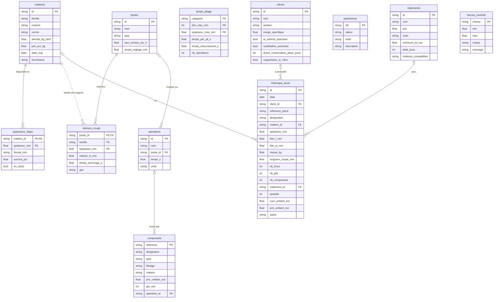

# `data` — base de référence des coûts

Base SQLite unique regroupant les 12 référentiels du chiffrage (matières, postes, opérations, paramètres, clients, historique…). SQLAlchemy 2.0 pour le schéma (`tables.py`), Alembic pour les migrations (`alembic/` à la racine).

**Le détail métier de chaque table** (rôle, colonnes, valeurs simulées, sources réelles) est dans [docs/sources_donnees.md](../../../docs/sources_donnees.md) — c'est la source de vérité, ne pas le dupliquer ici.

## Mise en route

```bash
uv run alembic upgrade head   # crée / met à jour data/devis.db (gitignorée)
```

## Conventions

- **Aucune valeur en dur** : tout chiffre utilisé dans un calcul vient de ces tables. Les valeurs simulées vivront dans un seul module de seed (à venir), pas dans le code du moteur.
- **Pydantic en lecture typée** : la base stocke, Pydantic valide et type à la lecture.
- **`parametres.valeur` est en texte** : elle accueille des nombres (`"0.25"`), des listes (`"1,10,100,1000"`) ou du texte (`"EUR"`) ; le cast dépend de la clé et se fait à la lecture.
- **Migrations** : écrites à la main et relues (l'autogenerate ne détecte pas les changements de clé primaire, et SQLite impose de recréer la table : `CREATE TABLE …_nouvelle`, `INSERT … SELECT`, `DROP`, `RENAME`). Vérifier `upgrade` **et** `downgrade` avant de committer.

## Schéma des tables



`parametres`, `temps_pliage` et `bornes_controle` sont des tables autonomes, sans clé étrangère. Le lien entre `vitesses_coupe` et `matieres` est logique (via la colonne `famille`, pas une clé étrangère) : il est en pointillés.
